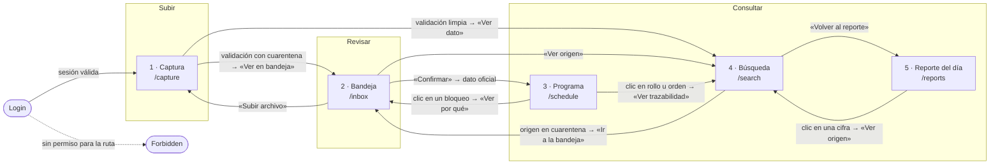
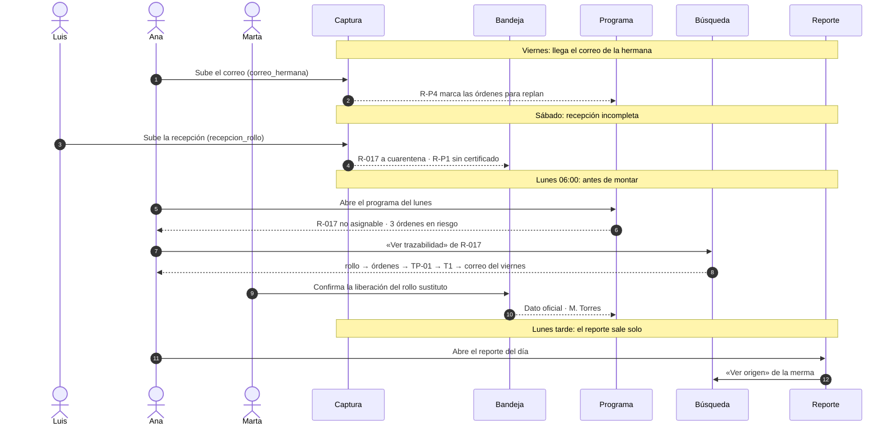

# Flujo de pantallas del caso C1

Estado: borrador para revisión (#11). Dueña: Kira. Revisa: Erik (sync del
16-nov).

Qué pantallas tiene DOCU en la Configuración 1, cómo se pasa de una a otra y
qué camino sigue cada persona del caso para resolver su tarea. La autoridad del
alcance es el mapa de derivación de [`../proyecto/CASO.md`](../proyecto/CASO.md)
§"Mapa de derivación"; este documento lo traduce a navegación. Las categorías y
etiquetas que se ven en las pantallas están en [`CATEGORIAS.md`](CATEGORIAS.md);
los colores, íconos y componentes, en [`DESIGN-SYSTEM.md`](DESIGN-SYSTEM.md).

## 1. Las cinco pantallas

El recorrido del caso es **subir → revisar → consultar**. Cada pantalla es un
paso de ese recorrido.

| # | Pantalla | Ruta | Paso | Flujos | Guiones | Permiso para entrar | Pregunta que responde |
|---|---|---|---|---|---|---|---|
| 1 | Captura | `/capture` | Subir | F2, F3, F4, F5 | G1, G2 | `files.upload` | ¿Entró mi archivo, de qué familia es y pasó la validación? |
| 2 | Bandeja | `/inbox` | Revisar | F4, F7 | G2, G3 | `inbox.review` | ¿Qué está detenido, por qué regla, y lo confirmo? |
| 3 | Programa | `/schedule` | Consultar | F1, F5, F7 | G4, G5 | `schedule.view` | ¿Qué entra a cada máquina y qué lo bloquea hoy? |
| 4 | Búsqueda | `/search` | Consultar | F6, F7, F8 | G5, G6 | `search.view` | ¿De qué archivo y regla salió esta cifra, y quién la confirmó? |
| 5 | Reporte del día | `/reports` | Consultar | F6 | G6 | `reports.view` | ¿Cómo cerró el día y cuál número cruzó el umbral? |

`Login` (`/login`) y `Forbidden` (`/forbidden`) vienen de la plataforma (#84):
no son parte de este flujo, pero lo enmarcan (§3).

La ruta `/reports` es nueva en #11: el permiso `reports.view` ya existe en la
plataforma, falta montar la ruta y la entrada del menú.

## 2. Diagrama de navegación

Flechas llenas: navegación con un clic desde un botón o enlace de la pantalla.
Flechas punteadas: menú principal (siempre visible, filtrado por permiso).

Regla de navegación: **desde cualquier cifra se llega a su origen en un clic**
(RF-04). Por eso Búsqueda es el destino de casi todas las flechas: es la
pantalla de la trazabilidad, no solo un buscador.

## 3. Lo que rodea al flujo

- **Entrada:** sin sesión, todas las rutas llevan a `/login`. Con sesión, la
  ruta vacía lleva a `/capture`.
- **Menú principal:** Captura · Bandeja · Programa · Búsqueda · Reporte. Solo
  muestra las pantallas que la sesión puede abrir; las demás no aparecen
  (no se muestran deshabilitadas).
- **Sin permiso:** si alguien abre una ruta por URL sin el permiso, la
  plataforma lo manda a `/forbidden`. El servidor es la autoridad (RF-06); la
  UI solo evita mostrar lo que no se puede usar.
- **Ruta desconocida:** lleva a `/capture`.
- **Celular (RNF-01):** el menú se colapsa en un botón con su nombre visible
  ("Menú"); las tablas se desplazan dentro de su marco y las acciones por fila
  pasan a un botón al final de cada tarjeta.

## 4. Tareas del usuario piloto y su camino

Las siete tareas salen de los flujos F1–F8 y de los guiones G1–G6. Cada tarea
tiene un camino por las pantallas; la columna "Termina cuando" es lo que se
cronometra en el recorrido del 16-nov (meta del brief: el flujo completo en
menos de 10 minutos).

| # | Persona | Tarea | Camino | Termina cuando | Flujo · guion · regla |
|---|---|---|---|---|---|
| T1 | Luis (almacén) | Registrar la recepción del sábado y saber si `R-017` puede programarse | Captura → Bandeja | Ve `R-017` en cuarentena con el motivo "Sin certificado (R-P1)" y el original intacto | F2 · G2 · R-P1 |
| T2 | Carmen (operadora) | Subir el Excel de turno de TP-01 y corregir el paro sin motivo | Captura → Bandeja | Ve su archivo en revisión con "Paro de 45 min sin motivo (R-A1)" y sabe qué falta | F3 · G1 · R-A1 |
| T3 | Marta (calidad) | Liberar el lote con su hoja de peel test escaneada | Captura → Bandeja → Confirmar | El dato queda **Oficial · Marta** con fecha, hora y regla | F4 · G3 · R-Q1 |
| T4 | Ana (planeación) | Revisar el programa del lunes y ver qué no puede correr | Programa → (bloqueo) Bandeja | Identifica los bloqueos vivos: `R-017` no asignable y material que no alcanza | F1 · G4 · R-P1, R-P3, R-T1 |
| T5 | Ana (planeación) | Ver qué cambió por el correo de la hermana y qué órdenes quedan en riesgo | Captura (correo) → Programa → Búsqueda | Ve las 3 órdenes que cuelgan de `R-017` y la marca de replan | F5, F7 · G5 · R-P4 |
| T6 | Andrés (materiales) | Saber de qué rollo salió una orden, de punta a punta | Búsqueda | Lee la cadena rollo → orden → máquina → turno → documento | F7, F8 · G5 |
| T7 | Ana y Marta | Leer el reporte del día y justificar la cifra de merma | Reporte → Búsqueda | Cada número del reporte cita su archivo y regla; ve la alerta de umbral si aplica | F6 · G6 |

**Personas que solo consultan** (Sergio, Pedro, Jorge, Miguel) usan los mismos
caminos con su alcance: no hay pantallas por persona, hay permisos por pantalla
(ROLES.md, #29).

### 4.1 El recorrido de la demo (rollo fantasma)

El recorrido cronometrado encadena las tareas en el orden del incidente:

## 5. Contrato de cada pantalla

Lo mínimo que cada pantalla muestra y permite. El detalle visual (componentes,
colores) se rige por `DESIGN-SYSTEM.md` §8–§9; los datos vienen del fixture
local de su dominio hasta que #61 entregue el corpus.

### 5.1 Captura · `/capture`

- **Muestra:** zona para arrastrar o elegir archivo (Excel, PDF, `.eml`,
  imagen); lista de lo subido en la sesión con nombre original, **familia
  asignada**, huella SHA-256 abreviada (mono) y resultado de la validación.
- **Acciones:** Subir archivo (principal) · Ver en bandeja (si cayó en
  cuarentena o revisión) · Ver dato (si pasó limpio).
- **Regla visible:** el original nunca se modifica; la pantalla lo dice al
  terminar ("El original quedó guardado tal cual").
- **Endpoints que consumirá (#4):** `POST /v1/files`, `GET /v1/files/:id/validation`.

### 5.2 Bandeja · `/inbox`

- **Muestra:** lo detenido y lo que espera confirmación; por fila: documento,
  familia, dato, cifra, **motivo**, **regla aplicada** (`R-*`), estado y, si
  ya se confirmó, quién y cuándo.
- **Acciones:** Confirmar (principal; solo quien tiene el permiso del dominio,
  p. ej. R-Q1: solo Calidad libera) · Mandar a cuarentena (modal con motivo
  obligatorio) · Ver origen · Subir archivo.
- **Filtros:** estado, familia, regla.
- **Endpoints:** `GET /v1/quarantine`, `POST /v1/inbox/:id/confirm`.

### 5.3 Programa · `/schedule`

- **Muestra:** el programa semanal por máquina y turno (`TP-01`…`TB-03`,
  T1–T3) con orden, material y rollo asignado; **bloqueos vivos** junto a la
  fila que bloquean (rollo no asignable, medida distinta, material que no
  alcanza, stock mínimo) y la marca de **replan** cuando entró un cambio de la
  hermana.
- **Acciones:** Ver por qué (lleva a la bandeja filtrada por esa regla) · Ver
  trazabilidad (rollo u orden) · Sincronizar fuente.
- **Endpoints:** `GET /v1/official-records`, `POST /v1/sources/:id/sync`.

### 5.4 Búsqueda · `/search`

- **Muestra:** buscador por rollo, orden, máquina o documento, con filtros por
  fecha y área (RF-04); resultado con la cifra y su **cita**: archivo de
  origen, regla aplicada, cálculo y quién confirmó; la cadena rollo → orden →
  máquina → turno → documento.
- **Acciones:** Buscar · Abrir original · Ir a la bandeja (si el origen está en
  cuarentena) · Volver al reporte.
- **Endpoints:** `GET /v1/lineage/:id`, `GET /v1/official-records`.

### 5.5 Reporte del día · `/reports`

- **Muestra:** el día elegido (por omisión, el último con datos) con buenas,
  merma, paros por máquina y bloqueos; **cada número cita su origen**; la
  alerta cuando una métrica cruza su umbral; aviso de **reporte pausado** si un
  cambio de la hermana (R-P4) lo dejó desfasado.
- **Acciones:** Ver origen (por cifra) · Elegir día · Descargar.
- **Endpoint:** `GET /v1/reports/day` (lo entrega #39; mientras, fixture).

## 6. Estados que toda pantalla resuelve

Cada pantalla tiene sus cuatro estados base más los dos del dato. Los textos
son la propuesta inicial; los íconos y colores son los de `DESIGN-SYSTEM.md` §8.

| Estado | Cuándo | Qué ve la persona | Salida |
|---|---|---|---|
| Cargando | Mientras llegan los datos | Esqueleto con la forma del contenido; "Cargando…" para lector de pantalla | — |
| Vacío | No hay datos para lo pedido | Invitación a actuar, nunca solo "No hay datos" (tabla abajo) | Botón a la acción que llena la pantalla |
| Error | Falló la carga o el servidor | Qué pasó y qué hacer en una frase | Reintentar |
| Con datos | Normal | El contenido de §5 | — |
| Cuarentena | Un dato quedó detenido | Badge **Cuarentena** + motivo + regla, siempre juntos | Ver en bandeja / Confirmar |
| Confirmado | Una persona lo confirmó | Badge **Oficial · nombre** + fecha y hora | Ver origen |

Textos de vacío por pantalla:

| Pantalla | Texto de vacío | Botón |
|---|---|---|
| Captura | Arrastra aquí tu Excel, PDF, correo o escaneo | Elegir archivo |
| Bandeja | Nada detenido: todo lo que subiste pasó la validación | Subir archivo |
| Programa | Aún no hay programa para esta semana | Sincronizar fuente |
| Búsqueda | Busca un rollo, una orden o una máquina (p. ej. `R-017`) | — (el campo tiene el foco) |
| Reporte | Este día todavía no tiene datos confirmados | Ir a la bandeja |

## 7. Qué falta decidir

- **Reporte en el menú para todos o solo jefes.** El permiso `reports.view`
  existe; falta confirmar con la matriz de ROLES.md quién lo tiene.
- **Captura en celular.** En Android no hay arrastrar y soltar: la zona se
  convierte en el botón "Elegir archivo" (y "Tomar foto" para escaneados).
  Confirmar con Erik si "Tomar foto" entra en C1.
- **Prueba con una persona del equipo** (brief §4, actividad 6): pendiente;
  aquí se anotará dónde se trabó y cuánto tardó por tarea.
