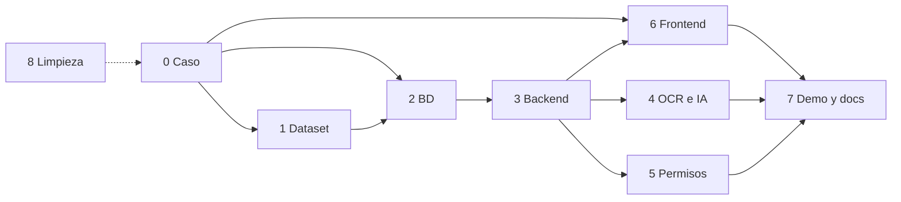

# Gestión: replanificación de C1 (2026-10-30)

Estado: **propuesta para revisión del líder**. Es el plan de trabajo derivado de la
auditoría del 2026-10-30 y de las decisiones del líder de ese día. Si discrepan,
gana GitHub Issues y el Project (capa de autoridad, `docs/README.md`), y este
archivo se corrige en el PR que lo reconcilia.

No reemplaza `PLAN-EPICAS.md`: ese sigue siendo la vista por órdenes. Este
documento fija **la secuencia nueva, las dos fechas que mandan, el método y la
limpieza**; al fusionarse, `PLAN-EPICAS.md` y `TRAZABILIDAD.md` se reescriben a
partir de aquí.

## 1. Por qué ahora

La auditoría del 2026-10-30 encontró doce huecos que no se pueden tapar con
fechas nuevas: el contrato de datos se cerró sin congelar (#23), el ER tiene tres formatos y
dos ADR en `Propuesta`, siete briefs de issues cerrados siguen activos, los
briefs de #11 y #41-fase2 apuntan a una rama (`design/kira-playground`) que ya
no existe, y el frontend, el backend y la base de datos **no han empezado**.

Decisiones del líder (2026-10-30):

1. El entregable es el **caso** (la línea de producción que se rompe, los problemas
   de comunicación, la pérdida de datos), no un producto genérico.
2. Primero se cierra el caos central: involucrados, responsabilidades, flujos,
   conversaciones y la planta real.
3. Después, los **documentos de prueba y demo**: dataset genérico y comprobable,
   replicable, para demostraciones en vivo y otros casos.
4. Después, el **backend completo** (ingesta, OCR, IA, permisos) y la **base de
   datos**.
5. El frontend deja de ser mockup suelto: son **mockups funcionales**, con
   tests, implementación real del caso, funciones completas y estilos
   profesionales según lo planeado.
6. Se trabaja con **SDD y TDD** para ir más rápido con IA sin perder seguridad.
7. Hay dos fechas: **24-nov** (presentación de avances con el profesor Yakko) y
   **3-dic** (presentación final, para todo el público).

## 2. Las dos fechas y qué se presume en cada una

| Fecha | Audiencia | Qué se presume | Qué NO se presume |
|---|---|---|---|
| **2026-11-24** | Profesor Yakko (avances) | El caso corriendo de punta a punta: captura → reglas declarativas → cuarentena → confirmación humana → dato oficial con trazabilidad → reporte. BD real con migración y seed, RBAC con roles del caso, frontend **funcional contra la API real**, OCR con corpus medido, IA proponiendo familia y confianza. Guion de la demo y dataset listos | Las seis familias completas, OCR es/en en vivo, permisos finos, estilos finales |
| **2026-12-03** | Público (final) | Todo lo anterior **completo**: las seis familias del contrato, OCR es/en en vivo, permisos completos, estilos profesionales, guion final y **replicabilidad** (una orden reproduce dataset, seed y demo) | Integraciones reales con SAP/CRM/dataPARC (C2) |

La diferencia entre ambas fechas no es "más o menos features": es **la misma
vertical, con más momentos del caso cerrados y pulida**.

## 3. Principio: el caso produce el contrato

Nada de pantallas ni endpoints se fijan por adelantado. El bloque 0 (caso)
produce los flujos; de los flujos se derivan, en cascada y con trazabilidad:

```
Caso (flujos, conversaciones, responsabilidades)
   ├─→ datos que entran por familia        → dataset y fichas
   ├─→ pantallas que usa cada rol           → mockups funcionales → frontend
   ├─→ endpoints que el flujo necesita      → API y worker
   ├─→ reglas del caso (datos)              → ReglaValidacion
   └─→ qué se demuestra y cómo              → guion de las dos demos
```

`ALCANCE-SOLUCION.md` §2 (los diez módulos de API) y las cuatro pantallas que
existen hoy en `apps/web` son **hipótesis a validar** contra el caso, no un
contrato cerrado. Si el caso exige una pantalla o un endpoint más, se agrega;
si sobra, se quita. El mapa de derivación queda en `CASO.md` y se revisa con
el líder antes de que arranque el frontend.

## 4. Secuencia de nueve bloques

| # | Bloque | Entregable (spec = brief) | Issues | Entrega | Área |
|---|---|---|---|---|---|
| 0 | **Caso** | `CASO.md` con involucrados, responsabilidades, flujos, conversaciones, la planta real y el mapa de derivación | nuevo | 6-nov | Erik + equipo |
| 1 | **Dataset** | Generador + dataset genérico y comprobable + **replicabilidad** | #61 + nuevo | 10-nov | Carlos |
| 2 | **Base de datos** | ER v1 (draw.io fuente + texto derivado) → migración Prisma → seed reproducible → `MODELO-DATOS.md` y **contrato congelado con SHA** | #58, #59, #60, #62, #23 | 12-nov | Emmanuel |
| 3 | **Backend** | Ingesta, reglas declarativas, cuarentena, confirmación, oficiales, lineage, worker | #12, #3, #46, #44 | 19-nov | Emmanuel |
| 4 | **OCR e IA** | Lectura de escaneados (fase 1) e IA que *propone* familia y confianza | nuevo | 20-nov | Erik + Emmanuel |
| 5 | **Permisos** | RBAC en servidor según `ROLES.md`, bitácora y solo-insert | #5 | 20-nov | Emmanuel + Carlos |
| 6 | **Frontend** | Mockups funcionales (spec de UI) y luego pantallas del caso contra la API real, tokens, tests y estilos profesionales | #11, #4 | 24-nov | Kira |
| 7 | **Demo y documentos** | Guion 24-nov y 3-dic, evidencias y replicabilidad | #6 | 3-dic | Erik + Carlos |
| 8 | **Limpieza** | Briefs al histórico, índices al día, ADRs resueltas, `verify` con tests y diagramas | nuevo | 6-nov | Erik |

Dependencias: el bloque 1 depende del 0 (el dataset sale de los formatos del
caso); el 2 del 1 (el seed sale del dataset); el 3 del 2; el 4 del 3 (la IA
propone sobre lo ya ingerido); el 6 del 0 para las pantallas y del 3 para la
API, y arranca con la spec de UI en paralelo; el 7 de todos.



## 5. El método: SDD y TDD

Hoy no existe forma de trabajar escrita: `plantillas/BRIEF.md` es un formato de
delegación y la API tiene cero pruebas. La decisión de método es permanente y
por eso va en ADR (ADR-0018), no en un issue.

| Pieza | Qué cambia |
|---|---|
| **ADR-0018** | Spec-Driven Development + TDD en DOCU: la spec es el brief, el código sigue a la spec, las pruebas van primero y la CI las exige |
| **`plantillas/BRIEF.md`** | Pasa a ser plantilla de **spec**: criterios de aceptación Given/When/Then, contrato de API y modelo esperado, plan de pruebas (unit, integración, e2e), evidencia de demo y criterio de "listo" |
| **`bun run verify`** | Corre `bun --filter api test` y `bun scripts/diagramas-check.ts`: sin suite de API no hay verify verde, y no hay PR de API sin pruebas |
| **Dataset como fixtures** | El mismo generador que produce la demo produce los datos de prueba; los tests de integración consumen el dataset, no archivos sueltos |
| **Regla de cierre** | Un issue se cierra con PR fusionado, `bun run verify` en verde, evidencia y criterios de aceptación cumplidos (ya está en `docs/REGLAS.md` 7) |

## 6. Inventario: qué se adapta de lo que ya existe

| Ya existe | Veredicto |
|---|---|
| `apps/web` con captura, bandeja, búsqueda y programa | **Punto de partida**, no el alcance: el conjunto final de pantallas lo deriva el caso (pueden ser más) |
| `ALCANCE-SOLUCION.md` §2 (diez módulos de API) | **Hipótesis** a validar contra el caso |
| `ingenieria/fichas/` (seis familias) + `CONTRATO.md` | **El contrato de datos**: se versiona contra el ER y se congela con SHA en el bloque 2 |
| `ingenieria/MODELO-DATOS.md`, `ARQUITECTURA.md`, `API.md`, `COLAS.md`, `IA.md`, `OCR.md` | Se actualizan al cerrar cada bloque (arquitectura describe el presente) |
| `proyecto/CASO.md` | Se **amplía**: conversaciones, responsabilidades por flujo y mapa de derivación |
| `proyecto/ROLES.md` | Es el contrato de permisos; el bloque 5 lo implementa, no lo reescribe |
| ER en draw.io | **draw.io es la fuente**, el texto (Mermaid) es el derivado que se diffa; `scripts/diagramas-check.ts` verifica que no se desincronicen; ADR-0017 se acepta con esa regla de dos artefactos y ADR-0016 queda reemplazada |
| `docs/superpowers/olas/`, `plans/`, `specs/` | **Histórico cerrado**: se marcan como superado por esta replanificación y no se editan |
| `docs/briefs/BRIEF-10, -13, -32, -41×2, -42, -43` | Al `docs/briefs/historico/` (la regla del índice ya lo exige) |
| `docs/briefs/BRIEF-11, -41-fase2` | Se reescriben: apuntaban a una rama que ya no existe |
| #34 (manuales) y #35 (capacitación) | **No se reabren**: venían de un tablero de Monday ya retirado; manuales, demos grabadas y capacitaciones quedan fuera de este alcance |
| `docs/README.md` (índice) y `gestion/TRAZABILIDAD.md` | Se actualizan con los datos reales del 30-oct |

## 7. Mapa de issues

Ningún issue se borra: los que desaparecen se cierran como `not planned` con
motivo (`docs/REGLAS.md` 4).

| Issue | Título actual | Título nuevo | Acción | Área | Entrega | Brief |
|---|---|---|---|---|---|---|
| nuevo | — | Caso C1: involucrados, responsabilidades, flujos y conversaciones | crear | Erik | 6-nov | BRIEF-caso-c1 |
| #61 | Generador automático + dataset + plan de pruebas | Dataset genérico y comprobable de C1 | reescribir | Carlos | 10-nov | BRIEF-61 |
| nuevo | — | Replicabilidad: una orden reproduce dataset, seed y demo | crear | Carlos | 12-nov | BRIEF-replicabilidad |
| #58 | Diagrama BD v0 (diseño, termina afirmado) | ER v1 de C1: draw.io fuente + texto derivado | reescribir | Emmanuel | 9-nov | BRIEF-58 |
| #59 | Diagrama BD v1 + seed C1 | Migración Prisma + seed reproducible desde el dataset | reescribir | Emmanuel | 12-nov | BRIEF-59 |
| #62 | Modelo de datos documentado | MODELO-DATOS.md + contrato congelado (SHA) | reescribir | Erik | 12-nov | BRIEF-62 |
| #60 | Arquitectura y modelo documentados | ARQUITECTURA.md y API.md de C1 | reescribir | Erik | 14-nov | BRIEF-60 |
| #23 | Contrato de datos congelado el 30 de octubre | Contrato de datos de C1 (congelado con SHA) | reabrir y cerrar con evidencia | Erik | 12-nov | — |
| #12 | API NestJS: modelo de datos, ingesta | API de ingesta y validación (módulos que pide el caso) | reescribir | Emmanuel | 19-nov | BRIEF-12 |
| #3 | Pipeline de ingesta, OCR y clasificación + integración | Pipeline: archivo → reglas → oficial | reescribir | Emmanuel | 19-nov | BRIEF-03 |
| #46 | Proceso worker de BullMQ con colas | se mantiene (sub-issue de #3) | — | Emmanuel | 19-nov | BRIEF-46 |
| #44 | Garantía solo-insert en la base de datos | se mantiene | — | Emmanuel | 19-nov | BRIEF-44 |
| #45 | Primeras pruebas de la API en CI | Puerta TDD: verify corre los tests de la API | reescribir | Emmanuel | 10-nov | BRIEF-45 |
| nuevo | — | OCR fase 1 e IA que propone familia y confianza | crear | Erik + Emmanuel | 20-nov | BRIEF-ocr-ia |
| #5 | RBAC en servidor, bitácora y reglas | se mantiene; implementación de `ROLES.md` | reescribir (fecha y criterio) | Emmanuel + Carlos | 20-nov | BRIEF-05 |
| #11 | Prototipos UI/UX y flujo de pantallas | Mockups funcionales: flujo del caso con datos reales | reescribir | Kira | 14-nov | BRIEF-11 |
| #4 | Frontend Angular: captura, bandeja, búsqueda y programa | Frontend del caso contra la API real, con tokens, tests y estilos | reescribir | Kira | 24-nov | BRIEF-04 |
| #7 | Configuración 1: carga de familias | C1: carga del dataset y verificación de punta a punta | reescribir | Emmanuel | 21-nov | BRIEF-07 |
| #6 | Ejecución de pruebas, evidencias | Demo 3-dic: guion, evidencia y replicabilidad | reescribir | Erik | 3-dic | BRIEF-06 |
| #34 | Elaboración manuales (cerrado) | — | se queda cerrado: fuera de alcance | — | — | — |
| #35 | Capacitación usuarios (cerrado) | — | se queda cerrado: fuera de alcance | — | — | — |
| #8 | Configuración 2: segunda instalación | C2: fuera de C1, se reprograma después del 3-dic | reprogramar | — | post-3-dic | BRIEF-08 |
| nuevo | — | SDD y TDD como método (ADR-0018, plantilla de spec, guardas) | crear | Erik | 6-nov | BRIEF-sdd-tdd |
| nuevo | — | Limpieza documental: briefs, índices, verify, docs históricos | crear | Erik | 6-nov | BRIEF-limpieza |

Los issues nuevos se numeran desde el siguiente libre (#81). Los briefs se
nombran `BRIEF-<issue>-<slug>`, con el número ya asignado. El ADR del método
toma el número libre que siga a la cadena del ER (0016 y 0017 se escribieron
en la rama de #58 y siguen sin commitear): si esa cadena cambia, el número se
reasigna y este documento se corrige.

## 8. Milestones y calendario

Se cierran los milestones que ya no mandan y se crean los nuevos. Antes de
cerrarlos, sus issues se mueven.

| Milestone nuevo | Fecha | Issues |
|---|---|---|
| `C1 modelo y BD` | 12-nov | #58, #59, #60, #62, #23, #45, #61, nuevo dataset, nueva replicabilidad |
| `C1 backend` | 21-nov | #12, #3, #46, #44, #5, #7, nuevo OCR/IA |
| `Avances profesor` | 24-nov | #11, #4 |
| `C1 final` | 3-dic | #6 |
| `Post-C1` | sin fecha | #8 |

Se cierran: `Cierre de diseño` (23-oct, cumplido con #41 el 29-oct),
`Fin del desarrollo` (20-nov), `Listos para presentar` (27-nov) y
`Presentación de diciembre` (1-dic).

Calendario de handoff entre bloques:

| Fecha | Handoff |
|---|---|
| 31-oct | Arranca el bloque 0 (caso) y el bloque 8 (limpieza) |
| 6-nov | Caso cerrado y derivado; método y limpieza listos |
| 10-nov | Dataset comprobable; puerta TDD activa (verify con tests) |
| 12-nov | ER v1, migración, seed y contrato congelado |
| 14-nov | Spec de UI (mockups funcionales) y documentación de arquitectura |
| 19-nov | Backend: ingesta, reglas, oficial, lineage, worker |
| 20-nov | OCR e IA; permisos por rol |
| 21-nov | Verificación de punta a punta con el dataset (#7) |
| 24-nov | Frontend funcional y **presentación con el profesor** |
| 26-nov | Estilos profesionales y pulido de la vertical |
| 30-nov | Guion final y evidencias |
| 3-dic | **Presentación final** |

## 9. Reparto

| Persona | Área | Bloques |
|---|---|---|
| **Erik** | En todo: es el dueño del caso y el que revisa | 0 (caso), 2 (documentación del contrato), 4 (OCR/IA), 7 (guion), 8 (limpieza), método SDD/TDD, revisión de cada entrega |
| **Emmanuel** | Backend | 2 (ER, migración, seed), 3 (API, pipeline, worker), 4 (integración), 5 (RBAC), 7 (verificación) |
| **Kira** | Frontend | 6 (spec de UI y pantallas del caso, tokens, tests, estilos) |
| **Carlos** | El resto | 1 (dataset y replicabilidad), 5 (apoyo en permisos), 7 (evidencias) |

Riesgo asumido: **Erik es cuello de botella** en seis bloques. Mitigación: sus
entregables son documentales (caso, contrato, guion), la implementación la
llevan los demás, y la revisión Erik es un punto único de control, no una cola
de código. Se respeta la regla de una persona, un issue `En progreso`.

## 10. Limpieza: qué se cierra para que nada quede a medias

- [ ] Briefs de issues cerrados al `docs/briefs/historico/` (#10, #13, #32, #41×2, #42, #43).
- [ ] BRIEF-11 y BRIEF-41-fase2 reescritos (ya no apuntan a una rama borrada).
- [ ] `docs/README.md`: el índice dice hoy que `diseno/` está pendiente y no
      lista los documentos nuevos.
- [ ] `gestion/TRAZABILIDAD.md` re-verificado contra GitHub (hoy dice 29/25;
      son 27/27) y con el hueco RF-07/RF-08 resuelto o declarado transversal.
- [ ] `gestion/PLAN-EPICAS.md` reescrito con la secuencia nueva.
- [ ] `docs/superpowers/` marcado como histórico superado.
- [ ] ADR-0016 y ADR-0017 resueltas: hoy están **solo en la rama de #58, sin
      commitear** (0016 "reemplazada por" una 0017 que nadie aprobó, así que la
      cadena está rota). Al aterrizar el ER se acepta la 0017 con la regla de
      dos artefactos, la 0016 queda reemplazada y `decisiones/README.md` queda
      al día.
- [ ] `bun run verify` corre tests de API y `diagramas:check`.
- [ ] Tablero: `Status`, fechas y Sprint coherentes con este plan; cero
      `En progreso` fantasma.

## 11. Criterios de aceptación de esta replanificación

1. El líder aprueba este documento.
2. Cada bloque tiene issue con dueño, fecha, brief-espec y criterio de "listo".
3. Los milestones nuevos existen en GitHub y los viejos están cerrados con sus
   issues movidos.
4. ADR-0018 escrito y revisado.
5. `plantillas/BRIEF.md` es plantilla de spec y `verify` exige tests de API.
6. `PLAN-EPICAS.md`, `TRAZABILIDAD.md` y `docs/README.md` reflejan el plan.
7. Los briefs cerrados están en `historico/` y el índice documental no miente.

## 12. Riesgos de la replanificación

| Riesgo | Señal | Mitigación |
|---|---|---|
| Erik se vuelve cuello de botella | Más de un bloque suyo en `En progreso` | Sus bloques son documentales; la implementación se delega |
| El ER (9-nov) se atrasa y empuja todo | Sin ER v1 al 10-nov | La regla de dos artefactos hace que el ER avance en días, no semanas; el seed usa el dataset, no el diagrama |
| La demo del 24-nov pide más de lo previsto | Peticiones nuevas del profesor | La vertical ya está corriendo; lo nuevo entra como enhancement del 3-dic |
| "Estilos profesionales" se come la última semana | Estilos sin empezar al 20-nov | Los tokens ya están; el style guide sale con la spec de UI (14-nov) |
| OCR en vivo no llega al 90 % | Corpus sin medir en la versión final | Fase 1 mide con corpus propio; si no llega, la demo del 3-dic usa el corpus medido y se dice así |
| El dataset no es reproducible | Dos corridas dan archivos distintos | Seed determinista y verificación en el brief de replicabilidad |

## 13. Lo que no cambia

- Las reglas del repo: `main` protegida, PR con revisor, `bun run verify` en
  verde, un cambio por commit, commits convencionales, nada de secretos.
- `ADR-0006` (la IA propone, el humano dispone) y `ADR-0012` (nada de producto
  antes de design system y modelo de datos): el caso se cierra, y luego se
  construye.
- `docs/REGLAS.md`: nada se borra, los issues que desaparecen se cierran como
  `not planned` con motivo.
- La documentación del sistema: lo que se cambia, se cambia con el código, en
  el repositorio, en español.
- **No hay manuales, demos grabadas ni capacitaciones**: vinieron de un tablero
  de Monday ya retirado y no son parte de este alcance. La evidencia que exige
  `docs/REGLAS.md` 7 (captura, bitácora o video) sigue vigente para cerrar
  issues.
