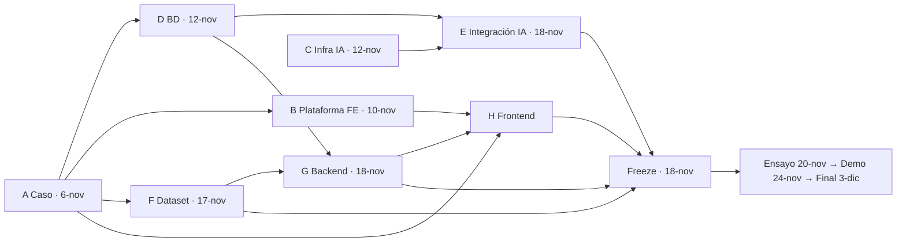

# Gestión: replanificación de C1 (2026-10-30, v2)

Estado: **vigente**. Aprobado por el líder (Erik) el 2026-10-30. Es el plan de
trabajo de la etapa C1: fija **la secuencia, los dos hitos que mandan, el
método, el reparto y la limpieza**. Si discrepan, gana GitHub Issues y el Project (capa de
autoridad, `docs/README.md`), y este archivo se corrige en el PR que lo reconcilia.

Esta versión (v2) sustituye la v1 del mismo día. Cambios de fondo: **la IA
vuelve a estar dentro del alcance** (OCR, embeddings y LLM consultable), el
**dominio de la BD se modela híbrido**, el **frontend se inicia ya**, la
**presentación del 24-nov se prepara y se ensaya antes**, y la responsabilidad
de la integración de IA queda explícitamente en el líder.

No reemplaza `PLAN-EPICAS.md`: ese sigue siendo la vista por órdenes. Este
documento fija la secuencia nueva; al fusionarse, `PLAN-EPICAS.md`,
`TRAZABILIDAD.md` y `docs/README.md` se reescriben a partir de aquí, en el mismo
PR.

## 1. Por qué ahora

La auditoría del 2026-10-30 encontró doce huecos que no se tapan con fechas
nuevas: el contrato de datos se cerró sin congelar (#23), el ER tenía tres
formatos y dos ADR en `Propuesta`, siete briefs de issues cerrados seguían
activos, los briefs de #11 y #41-fase2 apuntan a una rama que ya no existe, y
el frontend, el backend y la base de datos **no han empezado**.

Decisiones del líder (2026-10-30, en dos rondas):

1. El entregable es el **caso** (la línea de producción que se rompe, los
   problemas de comunicación, la pérdida de datos), no un producto genérico.
2. Primero se cierra el caos central: involucrados, responsabilidades, flujos,
   conversaciones y la planta real.
3. Después, el **backend completo** (ingesta, OCR, IA, permisos) y la **base de
   datos**.
4. El frontend deja de ser mockup suelto: son **mockups funcionales**, con
   tests, implementación real del caso, funciones completas y estilos
   profesionales.
5. Se trabaja con **SDD y TDD** para ir más rápido con IA sin perder seguridad.
6. Hay dos fechas: **24-nov** (presentación de avances con el profesor Yakko) y
   **3-dic** (presentación final, para todo el público).
7. **Nada específico del caso es código.** Familias, entidades, reglas, motores
   y volúmenes son datos. Una alteración del dataset o una familia nueva no
   pueden romper el sistema.
8. La **IA sí entra en C1**: sin OCR no hay caso real, y la búsqueda con
   procedencia es el centro de la idea.

## 2. Qué es C1 y qué entra

La vertical completa del caso Baja SterilPack: entra un documento real
(escaneado, Excel, correo), se extrae su contenido, se leen sus campos, se
proponen o se bloquean con reglas declarativas, un humano confirma, el dato
queda como oficial con su trazabilidad, y se puede **buscar y preguntar** sobre
él citando de dónde sale cada dato.

| Dentro de C1 | Fuera de C1 (queda `Could` / post-3-dic) |
|---|---|
| Caso cerrado: personas, flujos, conversaciones, qué falla y cómo se resuelve | Integraciones reales con SAP, CRM y dataPARC (C2) |
| BD completa: ER, DDL, enums, vistas, triggers, migración, seed | Manuales y capacitación (#34, #35, ya cerrados) |
| Dataset físico del mes: 60 turnos, 6 familias, válidos y con error | Voz, tableros configurables, gráficas guardables |
| Backend: ingesta genérica, reglas, cuarentena, oficial, lineage, RBAC, bitácora | Multi-tenant por cliente (ADR-0014 lo resuelve: por instalación) |
| IA integrada: OCR híbrido, embeddings 768, LLM consultable con citas | OCR es/en en vivo garantizado (se usa el corpus medido y se dice) |
| Frontend: mockups funcionales y pantallas del caso contra la API real | Sensores, predicción, envío de correo saliente |
| Worker BullMQ, replicabilidad del dataset y guion de las dos demos | Escalado, HA, observabilidad de producción |

**Regla compensatoria que no se negocia:** la plataforma funciona **sin IA**
para publicar. La IA propone; el humano dispone (ADR-0006, `VISION.md`
principio 1). Si un motor de IA falla, el sistema degrada a reglas
deterministas y sigue operando.

## 3. Regla de oro: nada específico del caso es código

> Lo único específico de Baja SterilPack son **datos**. El motor es agnóstico.

| Cosa del caso | Dónde vive | Cómo se agrega |
|---|---|---|
| Las 6 familias y sus campos | `family_config` (jsonb) + ficha | `INSERT` |
| Las 7 reglas (R-P1..R-T1) y su severidad | `validation_rule` (jsonb) | `INSERT` |
| Las entidades del dominio (Rollo, Orden, Máquina, Programa, Prueba) | `entity_type` + `entity` + `relation` | `INSERT` |
| El motor de OCR, el de embeddings y el LLM | Configuración por familia | `INSERT` |
| Los volúmenes, turnos y ruido del mes | Generador del dataset | Parámetros del generador |

Consecuencias de diseño:

- La ingesta registra la familia **por configuración** y parsea por un *kind*
  declarado (`excel`, `csv`, `pdf`, `image`, `eml`). No hay un parser por
  familia en el código.
- Una familia o una variante de formato desconocida **no rompe**: se procesa o
  va a cuarentena con motivo.
- El dominio se modela como datos genéricos (`entity_type`, `entity`,
  `relation`); `ingest`, `truth`, `config` y `platform` son tablas concretas y
  estables.

**Criterio de aceptación verificable (RF-08):** una prueba que (a) mete una
variación del dataset y (b) registra una familia nueva, y el sistema no se
rompe: procesa o va a cuarentena con motivo. Y en Configuración 2, `git diff`
de código vacío.

## 4. Las dos fechas, el freeze y el ensayo

| Fecha | Qué pasa | Qué se presume |
|---|---|---|
| **18-nov (mié)** | **Freeze de la vertical.** Nada nuevo entra; solo arreglos | Backend, IA, dataset y frontend integrated y corriendo de punta a punta |
| **19-nov (jue)** | Verificación de punta a punta, guion cronometrado, evidencias | La demo corre y se mide |
| **20-nov (vie)** | **Ensayo general** con el equipo y el profesor si puede | La demo se presenta en frío, con tiempo para corregir |
| **23-nov (lun)** | Arreglos de los fallos del ensayo | Demo lista |
| **24-nov (mar)** | **Presentación de avances con el profesor Yakko** | El caso corriendo de punta a punta |
| **26-nov (jue)** | Estilos profesionales y pulido de la vertical | La vertical se ve terminada |
| **30-nov (lun)** | Guion final, evidencias y replicabilidad | Todo listo para presentar |
| **3-dic (jue)** | **Presentación final** | Las seis familias, estilos profesionales, replicabilidad |

La diferencia entre ambas fechas no es "más o menos features": es **la misma
vertical, con más momentos del caso cerrados y pulida**.

**Regla de no arriesgar el 24-nov (obligatoria):**

1. La demo se ensaya el **20-nov**, no se prepara el 24.
2. El ensayo graba **video de respaldo** de la vertical completa.
3. Existe un **modo degradado** escrito: si el LLM falla en vivo, se muestra
   la búsqueda híbrida; si falla el OCR, se muestra el corpus ya procesado con
   su evidencia medida. El modo degradado se decide antes, no en el momento.
4. La demo corre **sin internet** (RNF-03): Ollama y modelos locales.
5. El guion tiene **roles asignados**: quién explica y quién opera.

## 5. Secuencia: ocho carriles

El trabajo corre en carriles porque las dependencias reales son pocas: la
base de datos no necesita los archivos físicos del dataset para diseñarse, y
el frontend no necesita el backend para hacer mockups.

| Carril | Dueño | Fechas | Entregable |
|---|---|---|---|
| **A. Caso** | Erik | 31-oct → **6-nov** | `CASO.md`: personas, flujos, conversaciones, qué falla → cómo se resuelve → por qué afecta y cómo; **mapa de derivación** (qué pantalla, qué endpoint, qué dato, qué regla y qué guion produce cada flujo) |
| **B. Plataforma frontend** | Erik | 31-oct → **10-nov** | En `main`: estructura atomic (`core` / `ui` / `features`), tokens de #41, kit de componentes, routing con guards y redirección, HTTP tipado, tests web, CI que corre lint + typecheck + tests |
| **C. Infra IA** | Erik | 3-nov → **12-nov** | Ollama con los modelos (GLM-OCR, Qwen3-Embedding, LLM), Laya por ONNX, scripts de setup, esqueleto del worker, medición de páginas/min en CPU |
| **D. Base de datos** | Erik | 7-nov → **12-nov** | ER híbrido (draw.io fuente + texto derivado), DDL + migración Prisma, **vistas, triggers y append-only en la base**, `infra/postgres/init`, contrato congelado con SHA |
| **E. Integración IA** | Erik | 13-nov → **18-nov** | OCR híbrido + embeddings 768 + LLM consultable con citas + búsqueda híbrida, sobre el DDL y el worker, con los motores como configuración |
| **F. Dataset** | Carlos | 31-oct → 17-nov | Generador determinista (se desarrolla en paralelo desde el 31-oct) y **emisión del mes** 13-nov → 17-nov: 60 turnos × 6 familias, válidos y con error, + manifiesto SHA-256 |
| **G. Backend** | Emmanuel | 3-nov → 19-nov | Specs y suite de pruebas desde el 3-nov; implementación 13-nov → 18-nov: API, ingesta genérica, reglas, cuarentena, oficial, lineage, seed, RBAC, bitácora; verificación de punta a punta 19-nov |
| **H. Frontend** | Kira | 6-nov → 18-nov | Spec de UI desde el 6-nov; mockups funcionales 13-nov → 16-nov; pantallas del caso contra la API real 17-nov → 18-nov |



**Handoffs:** 31-oct arranca A, B y el generador de F · 3-nov arranca C y las
specs de G · 6-nov caso cerrado y arranca H (spec de UI) · 10-nov plataforma
frontend en `main` · 12-nov BD congelada e infra IA lista · 13-nov arrancan E,
F (emisión), G (implementación) y H (mockups) · 17-nov dataset completo ·
18-nov freeze · 20-nov ensayo · 24-nov demo · 3-dic final.

## 6. Reparto

| Persona | Rol en esta etapa | Entregables |
|---|---|---|
| **Erik** (`reeinharddd`) | Líder. En el caso, en la BD, en la plataforma y en la IA. **Revisor único de todos los PRs** | A Caso · D BD · B Plataforma FE · C Infra IA · E Integración IA · guion de las dos demos · limpieza y harness |
| **Carlos** (`WearyBerry`) | Dataset físico y replicabilidad | F Generador + dataset del mes + manifiesto de hashes + apoyo en RBAC |
| **Emmanuel** (`Agent3835`) | Backend | G API + ingesta genérica + reglas + cuarentena + oficial + lineage + seed + RBAC + bitácora + tests |
| **Kira** (`kirxllix`) | Frontend | H Spec de UI + mockups funcionales + pantallas del caso contra API real + tokens y estilos |

### 6.1 Qué es exactamente el trabajo del líder

En esta etapa el trabajo del líder **no es escribir código a destajo**: es
**confirmar, delimitar y dejar el terreno listo** para que los demás trabajen
sin sorpresas. En concreto:

1. **Confirmar**: el motor de ingesta, el modelo de datos, los motores de IA y el
   contrato de las familias quedan decididos y escritos, con su motivo.
2. **Delimitar**: qué entra en C1 y qué no; qué regla bloquea y qué avisa; qué
   es dato y qué es código.
3. **Fijar el método**: SDD y TDD, `verify` como puerta única, brief como
   spec con criterios de aceptación.
4. **Fijar el orden y el seguimiento**: el calendario de §5, el freeze del
   18-nov, el ensayo del 20-nov y los handoffs entre carriles.
5. **Construir lo que habilita a los demás**: la base del frontend (B), el DDL
   y su migración (D) y el entorno de los modelos (C). Con eso, Carlos, Emmanuel
   y Kira no dependen de nadie para trabajar.

Riesgo asumido: **Erik acumula cinco frentes y además revisa todo**. Mitigación:
el orden interno es A → B → C → D → E, no se abre ningún frente nuevo después
del 14-nov, y hay un guardarraíl de des-recorte (§7.1).

## 7. Método, gates y guardarraíles

### 7.1 Guardarraíl de des-recorte (escrito, para no improvisar)

Si al **17-nov** el LLM consultable no está integrado, la demo del 24-nov
muestra **OCR + embeddings + búsqueda híbrida**, y el LLM se entrega el 3-dic.
No se mueve la fecha. Lo mismo aplica a cualquier pieza que se atrase: primero
se sacrifica lo último de la lista, nunca la fecha ni la vertical.

### 7.2 SDD y TDD

| Pieza | Qué cambia |
|---|---|
| **ADR-0018** | Spec-Driven Development + TDD en DOCU: la spec es el brief, el código sigue a la spec, las pruebas van primero y la CI las exige |
| **`plantillas/BRIEF.md`** | Pasa a ser plantilla de **spec**: criterios Given/When/Then, contrato de API y modelo esperado, plan de pruebas (unit, integración, e2e), evidencia de demo y criterio de "listo" |
| **`bun run verify`** | Corre `bun --filter api test` y `bun scripts/diagramas-check.ts`: sin suite de API no hay verify verde, y no hay PR de API sin pruebas |
| **Dataset como fixtures** | El mismo generador que produce la demo produce los datos de prueba; las pruebas de integración consumen el dataset, no archivos sueltos |
| **Regla de cierre** | Un issue se cierra con PR fusionado, `bun run verify` en verde, evidencia y criterios de aceptación cumplidos |

### 7.3 La puerta única: `bun run verify`

```
lint · typecheck · compose:check · harness:check · diagramas:check ·
doc-index · tests web · tests API · smoke:api · dataset:check · diagramas en sync
```

Sin suite de API no hay verify verde, y hoy `apps/api` **no tiene ni un test**.

## 8. Mapa de issues

Ningún issue se borra: los que desaparecen se cierran como `not planned` con
motivo (`docs/REGLAS.md` 4). Los nuevos se numeran desde el siguiente libre.
GitHub comparte contador entre issues y PRs, y el PR #82 (esta spec) ya tomó el
82: **los nuevos empiezan en #83**.

| Issue | Título nuevo | Acción | Dueño | Entrega | Brief |
|---|---|---|---|---|---|
| #58 | ER v1 de C1: draw.io fuente + texto derivado, DDL, vistas, triggers y migración | reescribir | Erik | 12-nov | `BRIEF-58` |
| #59 | Seed reproducible desde el dataset | reescribir | Emmanuel | 18-nov | `BRIEF-59` |
| #60 | Arquitectura y API de C1 | reescribir | Erik | 12-nov | `BRIEF-60` |
| #62 | Modelo de datos documentado + contrato congelado (SHA) | reescribir | Erik | 12-nov | `BRIEF-62` |
| #23 | Contrato de datos de C1 congelado | reabrir y cerrar con evidencia | Erik | 12-nov | — |
| #45 | Primeras pruebas de la API en CI (puerta TDD) | reescribir | Emmanuel | 12-nov | `BRIEF-45` |
| #61 | Dataset genérico y comprobable del mes | reescribir | Carlos | 17-nov | `BRIEF-61` |
| #12 | API de ingesta y validación | reescribir | Emmanuel | 18-nov | `BRIEF-12` |
| #3 | Pipeline: archivo → reglas → oficial | reescribir | Emmanuel | 18-nov | `BRIEF-03` |
| #46 | Worker de BullMQ con colas por tipo de trabajo | se mantiene | Emmanuel | 18-nov | `BRIEF-46` |
| #44 | Garantía solo-insert en la base | se mantiene | Emmanuel | 18-nov | `BRIEF-44` |
| #5 | RBAC en servidor, bitácora y reglas | reescribir | Emmanuel + Carlos | 18-nov | `BRIEF-05` |
| #7 | C1: carga del dataset y verificación de punta a punta | reescribir | Emmanuel | 19-nov | `BRIEF-07` |
| #11 | Mockups funcionales: flujo del caso con datos reales | reescribir | Kira | 16-nov | `BRIEF-11` |
| #4 | Frontend del caso contra la API real, con tokens, tests y estilos | reescribir | Kira | 18-nov | `BRIEF-4` |
| #6 | Demo final: guion, evidencia y replicabilidad | reescribir | Erik + Carlos | 3-dic | `BRIEF-6` |
| #8 | C2: segunda instalación | reprogramar post-3-dic | — | post-3-dic | `BRIEF-8` |
| #34, #35 | — | quedan cerrados: fuera de alcance | — | — | — |
| **#83** | Caso C1: involucrados, responsabilidades, flujos y conversaciones | crear | Erik | 6-nov | `BRIEF-83-caso-c1` |
| **#84** | Plataforma frontend: atomic, routing, kit, tests y CI | crear | Erik | 10-nov | `BRIEF-84-plataforma-frontend` |
| **#85** | Integración IA: OCR, embeddings y LLM consultable | crear | Erik | 18-nov | `BRIEF-85-integracion-ia` |
| **#86** | Replicabilidad: una orden reproduce dataset, seed y demo | crear | Carlos | 19-nov | `BRIEF-86-replicabilidad` |
| **#87** | SDD y TDD como método (ADR-0018, spec, guardas) | crear | Erik | 6-nov | `BRIEF-87-sdd-tdd` |
| **#88** | Limpieza documental: briefs, índices, verify, históricos | crear | Erik | 6-nov | `BRIEF-88-limpieza` |
| **#89** | Demo del 24-nov: guion, ensayo, video de respaldo y evidencias | crear | Erik | 20-nov | `BRIEF-89-demo-24-nov` |
| **#90** | Reconciliar GitHub y la documentación con la replanificación v2 | crear | Erik | 1-nov | `BRIEF-90-reconciliacion-github` |

## 9. Milestones

| Milestone | Fecha | Issues |
|---|---|---|
| `C1 modelo y BD` | 12-nov | #83, #84, #87, #88, #90, #58, #60, #62, #23, #45 |
| `C1 vertical completa` | 19-nov | #85, #86, #59, #61, #12, #3, #46, #44, #5, #7, #4, #11 |
| `Avances profesor` | 24-nov | #89 |
| `C1 final` | 3-dic | #6 |
| `Post-C1` | sin fecha | #8 |

Se cierran: `Cierre de diseño` (23-oct, cumplido con #41 el 29-oct),
`Fin del desarrollo` (20-nov), `Listos para presentar` (27-nov) y
`Presentación de diciembre` (1-dic).

## 10. Decisiones de ingeniería que hay que escribir

| ADR | Qué decide | Estado |
|---|---|---|
| ADR-0016 | Diagramas como texto Mermaid | **Reemplazada** por ADR-0017 (el ER es draw.io fuente + texto derivado) |
| ADR-0017 | El ER se edita en draw.io y el texto es derivado que se diffa | **Aceptada** cuando aterrice el ER |
| ADR-0018 | SDD y TDD como método de trabajo | Propuesta → aceptar con el issue de método |
| ADR-0019 | Dominio híbrido: `entity_type`/`entity`/`relation` genéricos + ingesta, verdad y config concretas | Propuesta → aceptar con el ER |
| ADR-0020 | Los motores de OCR, embeddings y LLM son **configuración**, no código | Propuesta → aceptar con la integración IA |

La numeración 0018–0020 es provisional: depende de la cadena del ER, que
todavía está sin commitear en la rama de #58. Si esa cadena cambia, se
reasignan los números y este documento se corrige.

## 11. Inventario: qué se adapta de lo que ya existe

| Ya existe | Veredicto |
|---|---|
| `apps/web` con captura, bandeja, búsqueda y programa | **Punto de partida**, no el alcance: el conjunto final de pantallas lo deriva el caso |
| `apps/web/src/app/app.routes.ts` está vacío | Se llena en la plataforma frontend (B) |
| `ALCANCE-SOLUCION.md` §2 (diez módulos de API) | **Hipótesis** a validar contra el caso |
| `ingenieria/fichas/` (seis familias) + `CONTRATO.md` | El contrato de datos: se versiona contra el ER y se congela con SHA en el bloque D |
| `ingenieria/MODELO-DATOS.md` | Se **reescribe** al modelo híbrido; hoy contradice al ER |
| `ingenieria/ARQUITECTURA.md`, `API.md`, `COLAS.md`, `IA.md`, `OCR.md`, `EMBEDDINGS.md` | Se actualizan al cerrar cada bloque |
| `proyecto/CASO.md` | Se **amplía**: conversaciones, responsabilidades por flujo y mapa de derivación |
| `proyecto/ROLES.md` | Es el contrato de permisos; el bloque de permisos lo implementa, no lo reescribe |
| ER en draw.io | draw.io es la **fuente**; el texto Mermaid es el derivado que se diffa; `scripts/diagramas-check.ts` verifica que no se desincronicen |
| `docs/superpowers/olas/`, `plans/`, `specs/` | **Histórico cerrado**: superado por esta replanificación, no se editan |
| `docs/briefs/BRIEF-10, -13, -32, -41×2, -42, -43` | Al `docs/briefs/historico/` |
| `docs/briefs/BRIEF-11, -41-fase2` | Se reescriben: apuntaban a una rama borrada |
| `docs/README.md` y `gestion/TRAZABILIDAD.md` | Se actualizan con los datos reales del 30-oct |

## 12. Limpieza: qué se cierra para que nada quede a medias

- [ ] Briefs de issues cerrados al `docs/briefs/historico/` (#10, #13, #32,
      #41×2, #42, #43).
- [ ] BRIEF-11 y BRIEF-41-fase2 reescritos.
- [ ] `docs/README.md`: el índice dice hoy que `diseno/` está pendiente y no
      lista los documentos nuevos.
- [ ] `gestion/TRAZABILIDAD.md` re-verificado contra GitHub (hoy dice 29/25; son
      27/27) y con el hueco RF-07/RF-08 resuelto o declarado transversal.
- [ ] `gestion/PLAN-EPICAS.md` reescrito con la secuencia nueva.
- [ ] `docs/superpowers/` marcado como histórico superado.
- [ ] ADR-0016 y ADR-0017 resueltas: la 0017 se acepta con la regla de dos
      artefactos, la 0016 queda reemplazada y `decisiones/README.md` al día.
- [ ] `bun run verify` corre tests de API, `dataset:check` y `diagramas:check`.
- [ ] Tablero: `Status`, fechas y Sprint coherentes con este plan; cero
      `En progreso` fantasma.

## 13. Criterios de aceptación de esta replanificación

1. El líder aprueba este documento. ✔ (2026-10-30)
2. Cada bloque tiene issue con dueño, fecha, brief-espec y criterio de "listo".
3. Los milestones nuevos existen en GitHub y los viejos están cerrados con sus
   issues movidos.
4. ADR-0018, ADR-0019 y ADR-0020 escritos y revisados.
5. `plantillas/BRIEF.md` es plantilla de spec y `verify` exige tests de API.
6. `PLAN-EPICAS.md`, `TRAZABILIDAD.md` y `docs/README.md` reflejan el plan.
7. Los briefs cerrados están en `historico/` y el índice documental no miente.
8. El ensayo del 20-nov se hizo, con video de respaldo y modo degradado
   escrito.

## 14. Riesgos

| Riesgo | Señal | Mitigación |
|---|---|---|
| Erik acumula cinco frentes y revisa todo | Más de un frente suyo abierto a la vez | Orden interno A → B → C → D → E; nada nuevo después del 14-nov; guardarraíl de des-recorte (§7.1) |
| La demo del 24-nov falla en vivo | Un fallo aparece en el ensayo del 20-nov | Freeze el 18-nov, ensayo el 20-nov, video de respaldo, modo degradado escrito, demo sin internet |
| El dataset depende del caso y de la BD | El contrato no se congela el 12-nov | El generador se desarrolla en paralelo desde el 31-oct; solo la emisión espera al contrato |
| La IA no alcanza en CPU | Páginas/min por debajo del umbral en el corpus de C1 | Se mide en el carril C; si no alcanza, la demo usa el corpus medido y se dice |
| La plataforma frontend bloquea a Kira | La base no está en `main` el 10-nov | Kira avanza con la spec de UI desde el 6-nov; el bloqueo real es de código, no de diseño |
| El caso se cablea en el código | Un `if` con nombre del caso o de la familia | Criterio de aceptación verificable (§3) y revisión de config primero |
| Dos modelos de datos en el repo | `MODELO-DATOS.md` contradice al ER | El híbrido manda; `MODELO-DATOS.md` se reescribe en el mismo PR del ER |
