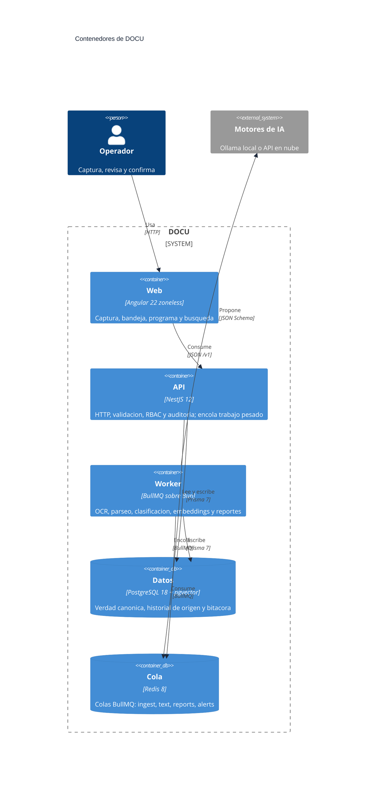
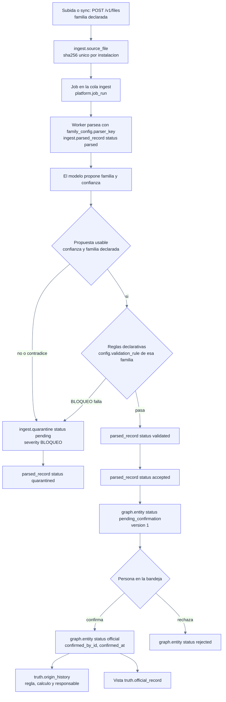
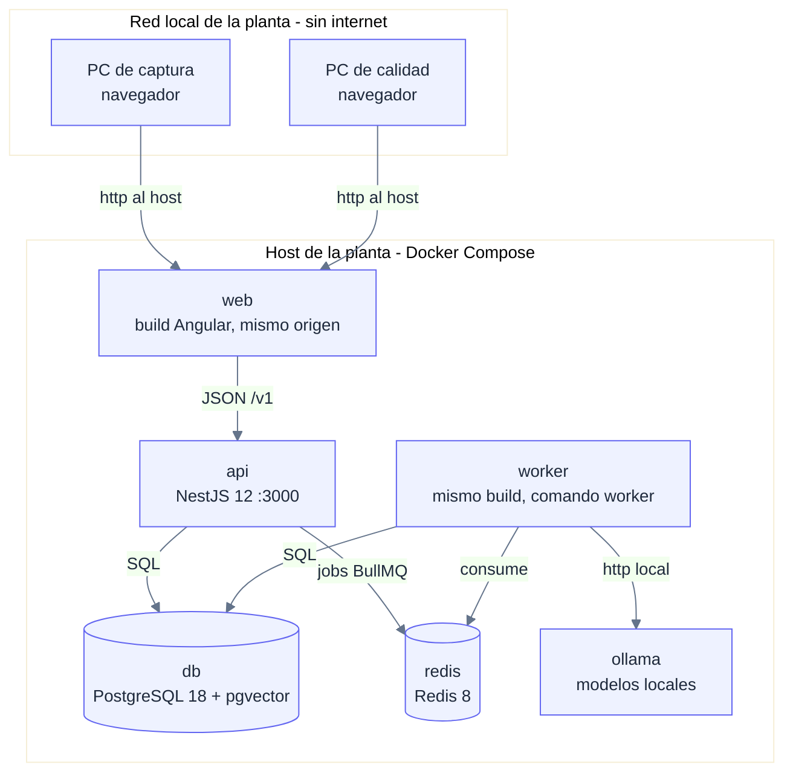

# Arquitectura: cómo se conectan las piezas

Estado: vigente. Describe el sistema **actual** y el camino ya decidido. El
futuro lejano va en [ADR](../decisiones/README.md), no aquí.

Este documento es la autoridad de **cómo se construye C1**: qué procesos
existen, qué módulo responde qué ruta, qué tabla se toca en cada endpoint y
qué error sale cuando algo falla. La superficie de producto está en
[ALCANCE-SOLUCION.md](ALCANCE-SOLUCION.md); el presente de la API, en
[API.md](API.md); el modelo, en [DIAGRAMA-BD-v0.md](DIAGRAMA-BD-v0.md).

## 0. Cómo leer este documento

Tres marcas, usadas en todas las tablas:

| Marca | Significa |
|---|---|
| **vigente** | Ya existe en el repositorio y se puede ejecutar hoy |
| **decidido** | Contrato cerrado y escrito aquí; todavía no está construido |
| **abierto** | Falta una decisión o una pieza; se dice quién la cierra |

**Estado del modelo que usa este documento.** La matriz de endpoints se
escribe contra el **ER v1** (25 tablas en 6 esquemas, 2 vistas, 4 disparadores
solo-insert), que es el resultado de #58 y vive en la rama
`feat/58-diagrama-v0`, **pendiente de merge**. En `main` hoy solo está
documentada la Fase 1 (`core`, 10 tablas). Toda tabla citada aquí lleva el
modelo v1; si al aterrizar #58 cambia un nombre, se corrige este documento en
el mismo PR.

**Una autoridad por dato.** El sobre de error y sus códigos están solo en
[ALCANCE-SOLUCION.md §2.1](ALCANCE-SOLUCION.md) y
los consume el front tal cual
(`apps/web/src/app/core/types/api-error.ts`). Las versiones están solo en
[STACK.md](STACK.md). Las reglas del caso están solo en
[ROLES.md](../proyecto/ROLES.md). Aquí no se repiten: se citan.

## 1. Mapa de procesos

| Proceso | Dónde vive | Puerto | Responsabilidad | Marca |
|---|---|---|---|---|
| `db` | Docker Compose (`pgvector/pgvector:pg18`) | 5432 | Datos canónicos, historial de origen, bitácora | vigente |
| `redis` | Docker Compose (`redis:8`) | 6379 | Cola de trabajo y caché con TTL | vigente |
| `api` | `apps/api/src/main.ts` | 3000 | HTTP, validación, RBAC, auditoría. **No ejecuta OCR ni parseo** | vigente (solo `/health` existe) |
| `worker` | Misma imagen que la API, comando worker | — | Consume la cola: OCR, parseo, clasificación, embeddings, reportes | decidido (#46) |
| `web` | `apps/web` (dev server) | 4200 | Captura, bandeja, programa, búsqueda | vigente |

**La API no ejecuta trabajo pesado** ([ADR-0011](../decisiones/ADR-0011-api-encola-worker-procesa.md)):
encola y responde. El único endpoint que existe hoy es `GET /health`
(`apps/api/src/health/health.controller.ts`), que abre un cliente `pg`
efímero y hace `PING` a Redis.

### 1.1 Quién habla con quién

| Origen | Destino | Mecanismo | Contrato | Fallo visible |
|---|---|---|---|---|
| Angular | API | HTTP/JSON bajo `/v1` | [§3](#3-contrato-de-endpoints) de este documento | Mensaje en pantalla, nunca bloqueo silencioso (RNF-01) |
| API | Postgres | Prisma 7 + `@prisma/adapter-pg` | `DATABASE_URL` | Error del sobre; el job se marca fallido |
| API | Redis | BullMQ `Queue` con ioredis | Jobs `{ sourceFileId, sha256, familyConfigId }` | Reintento y después cuarentena con motivo |
| Worker | Redis | BullMQ `Worker` y `QueueEvents` | Conexiones separadas: **nunca** compartir | El worker no arranca; `/health` no lo detecta todavía |
| Worker | Postgres | Prisma 7 | Resultado del job: `parsed_record`, `quarantine`, `entity` | Todo error deja motivo en `audit_log` o `quarantine` |
| Worker | Modelo IA | HTTP a Ollama en localhost o API en nube | Salida forzada a JSON Schema, validada con Zod | Sin confianza alta: a cuarentena, nunca a oficial |
| Todos | GitHub | Git + PR + CI | Ramas `feat/<ID>-<slug>`, 1 revisor | CI en rojo bloquea el merge |

## 2. Los módulos de la API

Un módulo por dominio, con la convención de [API.md](API.md) §"Convenciones ya
fijadas". Cada módulo declara qué usa y **no** importa de otro dominio: el
cruce se hace por la base o por la cola.

| Módulo | Responde | Responsabilidad | **No** hace | Tablas (ER v1) | Marca |
|---|---|---|---|---|---|
| `files` | `POST /v1/files` | Recibe el archivo, calcula `sha256`, registra el original, encola el trabajo | No parsea, no clasifica, no publica | `ingest.source_file`, `platform.job_run`, `truth.audit_log` | decidido |
| `sources` | `POST /v1/sources/:id/sync` | Trae documentos de una fuente y los mete al mismo pipeline | No distingue el pipeline de la subida manual | `ingest.source_file`, `platform.job_run`, `truth.audit_log` | decidido |
| `classification` | `GET /v1/files/:id/classification` | Devuelve la familia declarada y la propuesta del modelo con su confianza | No decide validity ni publica | `ingest.source_file`, `ingest.parsed_record`, `config.family_config` | decidido |
| `validation` | `GET /v1/files/:id/validation` | Devuelve el resultado de la cadena de reglas declarativas | No ejecuta reglas: las lee de datos | `ingest.quarantine`, `config.validation_rule`, `ingest.parsed_record` | decidido |
| `quarantine` | `GET /v1/quarantine` | Bandeja de lo detenido, con motivo y código de regla | No borra nada | `ingest.quarantine`, `ingest.source_file` | decidido |
| `inbox` | `GET /v1/inbox`, `POST /v1/inbox/:id/confirm`, `POST /v1/inbox/:id/reject` | Bandeja de revisión humana y las dos disposiciones posibles | No propone: recibe la propuesta ya hecha | `graph.entity`, `graph.entity_type`, `truth.origin_history`, `truth.audit_log` | decidido |
| `official-records` | `GET /v1/official-records` | Dato confirmado, con su fuente y su responsable | No escribe: solo lee la vista | vista `truth.official_record` | decidido |
| `lineage` | `GET /v1/lineage/:id` | Encadenamiento del dato hasta su documento y su regla | No recalcula: no inventa el linaje | vista `truth.entity_lineage`, `graph.relation` | decidido |
| `auth` | `POST /v1/auth/login`, `POST /v1/auth/logout` | Sesión y roles; el servidor es la autoridad de permisos | No delega el permiso al front | `core.app_user`, `core.user_role`, `core.role`, `core.role_permission`, `core.permission`, `platform.session` | decidido |
| `reports` | `GET /v1/reports/day` | Reporte del día, derivado de lo oficial | No publica dato que no sea oficial | vista `truth.official_record`, `platform.job_run` | decidido |

**`reports` y `alerts` también son colas** (`platform.job_run.queue` acepta
`ingest`, `text`, `reports`, `alerts`), pero en C1 el único consumible del
front es el reporte del día; los recurrentes y las alertas son de #39.

## 3. Contrato de endpoints

Convenciones transversales, válidas para toda la tabla:

| Regla | Decisión | Dónde se define |
|---|---|---|
| Versión | Todo el producto vive bajo `/v1` | [API.md](API.md), y el front ya lo antepone (`apps/web/src/app/core/config/api-url.ts:9`) |
| Sobre de error | Todo no-2xx devuelve `{ code, message, details? }` con 7 códigos estables | [ALCANCE-SOLUCION.md §2.1](ALCANCE-SOLUCION.md) (canónico) |
| Autenticación | `Authorization: Bearer <token>` con token opaco, no JWT | [ADR-0021](../decisiones/ADR-0021-token-opaco-con-revocacion-inmediata.md) |
| Paginación | `limit` (50 por defecto, 200 máximo) y `offset`; respuesta **array plano** y total en `X-Total-Count` | [ADR-0022](../decisiones/ADR-0022-paginacion-por-limit-y-offset.md) |
| Idempotencia | `POST /v1/files` calcula el `sha256` en el servidor; repetido = `409 CONFLICT` con `details.sourceFileId` | Este documento, §3.2 |
| Permisos | El servidor evalúa rol, alcance, dominio y vigencia | [ROLES.md](../proyecto/ROLES.md) §3 |
| Aislamiento | Toda consulta filtra por instalación **y** por alcance del recurso: un identificador manipulado no cruza de instalación | Este documento, §3.4 |
| Token en el navegador | Bearer solo en memoria, CSP restrictiva, sanitización de lo que viene de la API; cerrar la pestaña sin logout deja la sesión viva hasta que expira | [ALCANCE-SOLUCION.md §2.1](ALCANCE-SOLUCION.md), [ADR-0021](../decisiones/ADR-0021-token-opaco-con-revocacion-inmediata.md) |

`GET /health` queda **fuera** de `/v1`: es una puerta operativa, no parte del
contrato de producto.

### 3.1 Matriz endpoint ↔ módulo ↔ tablas ↔ errores

`2xx` es el código de éxito; el resto son los códigos HTTP con su `code` del
sobre de error.

| Endpoint | Módulo | Tablas o vistas (ER v1) | Permiso | Respuesta `2xx` | Errores |
|---|---|---|---|---|---|
| `POST /v1/files` | `files` | INSERT `ingest.source_file`, `platform.job_run`, `truth.audit_log` | `create` + `submit` | `201` `{ sourceFileId, sha256 }` | `409` duplicado · `422` tipo, tamaño o familia · `401` `403` `429` |
| `GET /v1/files/:id/classification` | `classification` | `ingest.source_file`, `ingest.parsed_record`, `config.family_config` | `read` | `200` familia y propuesta con confianza | `404` · `401` `403` |
| `GET /v1/files/:id/validation` | `validation` | `ingest.quarantine`, `config.validation_rule`, `ingest.parsed_record` | `read` | `200` reglas y su resultado | `404` · `401` `403` |
| `POST /v1/sources/:id/sync` | `sources` | INSERT `ingest.source_file`, `platform.job_run`, `truth.audit_log` | `create` | `202` `{ jobId }` | `404` fuente · `409` sincronización en curso · `401` `403` `429` |
| `GET /v1/quarantine` | `quarantine` | `ingest.quarantine` + `ingest.source_file` | `read` | `200` array de detenidos | `422` filtro inválido · `401` `403` |
| `GET /v1/inbox` | `inbox` | `graph.entity` (`pending_confirmation`), `graph.entity_type`, `ingest.source_file` | `read` | `200` array de propuestas | `401` `403` |
| `POST /v1/inbox/:id/confirm` | `inbox` | UPDATE `graph.entity`, INSERT `truth.origin_history`, `truth.audit_log` | `confirm` | `200` `{ id, status, version, confirmedAt }` | `404` · `409` ya disposed · `422` no está en revisión · `401` `403` |
| `POST /v1/inbox/:id/reject` | `inbox` | UPDATE `graph.entity`, INSERT `truth.audit_log` | `confirm` | `200` `{ id, status, version }` | `404` · `409` ya disposed · `422` no está en revisión · `401` `403` |
| `GET /v1/official-records` | `official-records` | vista `truth.official_record` | `read` | `200` array de oficiales | `422` filtro inválido · `401` `403` |
| `GET /v1/lineage/:id` | `lineage` | vista `truth.entity_lineage`, `graph.relation` | `read` | `200` entidad, historial y relaciones | `404` · `401` `403` |
| `POST /v1/auth/login` | `auth` | `core.app_user`, `core.user_role`, `core.role`, `core.role_permission`, `core.permission`, INSERT `platform.session` | público | `200` `{ token, tokenType, expiresAt, user, permissions }` | `401` credenciales · `422` cuerpo · `429` intentos |
| `POST /v1/auth/logout` | `auth` | UPDATE `platform.session` (`revoked_at`) | con sesión | `204` sin cuerpo | `401` |
| `GET /v1/reports/day` | `reports` | vista `truth.official_record` (agregado), `platform.job_run` (cola `reports`) | `read` | `200` `{ date, total, items }` | `422` fecha inválida · `401` `403` |

Formas de las peticiones:

| Método y ruta | Cuerpo | Notas |
|---|---|---|
| `POST /v1/files` | `multipart/form-data` con el archivo y la familia declarada | El servidor valida tamaño, tipo real y familia; el front solo valida por UX |
| `POST /v1/sources/:id/sync` | vacío | El `:id` es el código de la fuente configurada |
| `GET /v1/files/:id/*` | — | `:id` es el `id` de `ingest.source_file` |
| `POST /v1/inbox/:id/confirm` y `/reject` | vacío | `:id` es el `id` de `graph.entity` |
| `GET /v1/lineage/:id` | — | `:id` es el `id` de `graph.entity` |
| `POST /v1/auth/login` | JSON `{ username, password }` | La contraseña se compara contra `core.app_user.password_hash` |
| `GET /v1/reports/day` | — | Query `date=YYYY-MM-DD`; sin `date`, hoy |

### 3.2 Idempotencia de la ingesta

`POST /v1/files` calcula el `sha256` del bytes recibido **en el servidor** y
lo guarda en `ingest.source_file`, que es único por
`(facility_id, sha256)` en el ER v1. Subir dos veces el mismo archivo:

- La segunda devuelve `409 CONFLICT` con `details.sha256` y
  `details.sourceFileId` apuntando al original existente.
- No se crea una segunda fila ni un segundo job.

El `originales/` es de solo lectura y nada se borra en silencio: el archivo
queda registrado una vez y para siempre.

**El hueco que esta regla todavía no cubre.** Registrar en PostgreSQL y
encolar en Redis son dos pasos y no forman una transacción: si la fila se
escribe y el encolado falla, el archivo queda registrado sin procesar, y un
reintento del mismo archivo devuelve `409` por `sha256` duplicado **sin
re-encolar**. Para cerrarlo hace falta una de dos: un *transactional outbox*
(la fila y el trabajo se escriben juntos y un lector los despacha), o una
reconciliación que detecte `source_file` sin `parsed_record` y lo vuelva a
encolar. Mientras no exista, la idempotencia de esta sección es cierta solo
cuando el encolado sí tuvo éxito. Owner: #12 (API) y #46 (worker), antes de
que la ingesta sea real.

### 3.3 Claves de permiso del servidor contra las del front

El ER v1 fija los códigos de permiso del servidor (`core.permission.code`):
`read`, `download`, `create`, `update`, `submit`, `confirm`, `release`,
`quarantine`, `manage_users`, `manage_permissions`, `manage_config`,
`view_audit`. El front usa claves de UI
(`apps/web/src/app/core/types/permissions.ts`): `files.upload`,
`inbox.review`, `quality.release`, `schedule.view`, `search.view`,
`reports.view`. **No son el mismo vocabulario** y hoy no hay tabla que los
traduzca. Mapeo que propone esta arquitectura para que #5 y #12 lo
implementen:

| Clave del front | Permiso del servidor | Nota |
|---|---|---|
| `files.upload` | `create` + `submit` | Subir y enviar a revisión son actos distintos ([ROLES.md](../proyecto/ROLES.md) §3) |
| `inbox.review` | `read` + `confirm` | `read` lista la bandeja; `confirm` es la disposición |
| `quality.release` | `release` | Liberación operativa (R-Q1); no es `confirm` |
| `schedule.view` | `read` | |
| `search.view` | `read` | |
| `reports.view` | `read` | |

Este mapeo es **decidido**, pero su implementación es de #5 (motor de
permisos) y #12 (API). El front sigue usando sus claves de UI; el servidor
manda.

### 3.4 Aislamiento por instalación en cada consulta

Comprobar que el usuario tiene permiso `read` **no basta**: el permiso dice
qué acción se permite, no sobre qué filas. La instalación es el límite duro
([ADR-0014](../decisiones/ADR-0014-instalacion-single-company.md), y
[ROLES.md](../proyecto/ROLES.md) §3 lo llama `alcance del recurso`), y toda
consulta de producto se filtra por ella.

| Regla | Qué significa | Marca |
|---|---|---|
| El filtro va en la consulta, no en el código de la ruta | Cada lectura y cada escritura incluye `facility_id` derivado de la **sesión**, nunca del `id` que llega en la URL | decidido |
| Un `:id` de otra instalación es `404`, no `403` | Responder `403` confirmaría que el recurso existe en otro lado | decidido |
| El aislamiento también lo sostiene la base | Las FK del ER v1 son compuestas con `facility_id` en las tablas de negocio (`entity`, `source_file`, `parsed_record`, `origin_history`); las 21 FK que no la llevan apuntan a catálogos globales o a la jerarquía de departamentos, y son el hueco que #58 cierra | decidido (#58) |
| Las columnas de actor no reemplazan el filtro | `created_by_id`, `confirmed_by_id` y `actor_id` son referencias a `core.app_user` sin `facility_id` en la FK: sirven para saber quién, no para autorizar | decidido |

Implementación: #5 (motor de permisos) y #12 (API). Hoy el front ya filtra por
instalación en la UI, lo cual **no es seguridad**: el filtro real va en el
servidor.

### 3.5 Sesión en el servidor y token en el navegador

La forma del token ya está decidida en
[ADR-0021](../decisiones/ADR-0021-token-opaco-con-revocacion-inmediata.md):
opaco, aleatorio, hasheado en `platform.session`, con `revoked_at` para
revocar de inmediato. Lo que esta arquitectura fija es el **ciclo de vida
completo** y lo que pasa en el navegador:

| Aspecto | Regla | Marca |
|---|---|---|
| Expiración | 8 horas desde `issued_at`, renovable por actividad (`last_seen_at`) | decidido (ADR-0021) |
| Renovación | Cada petición autenticada refresca `last_seen_at`; la ventana se renueva mientras haya actividad | decidido (ADR-0021) |
| Revocación | `revoked_at` surte efecto en la siguiente petición | decidido (ADR-0021) |
| Logout | `POST /v1/auth/logout` revoca la fila; el front limpia su estado local | decidido (ADR-0021) |
| Cierre de pestaña sin logout | La sesión **sigue viva** hasta `expires_at`: el token está en memoria, no en el servidor. Hoy el `signOut()` del front solo limpia el estado local (`auth.service.ts:57`) y no llama a la API; hay que llamar `POST /v1/auth/logout` al cerrar, y el `401` por `expires_at` resuelve el resto | decidido (ADR-0021) |
| Limpieza de sesiones abandonadas | Las sesiones vencidas o revocadas se purgan por `expires_at`; nada crece sin techo. `last_seen_at` distingue la sesión viva de la abandonada | decidido |
| Token en el navegador | Solo en memoria (signals), nunca en `localStorage` ni `sessionStorage`; hoy el front corre con sesión demo y `token: null` hasta que #12 conecte el login real | decidido ([ALCANCE-SOLUCION.md §2.1](ALCANCE-SOLUCION.md)) |
| CSP | El host que sirve el front envía `Content-Security-Policy` restrictiva: sin `unsafe-inline` para scripts, sin `unsafe-eval`, y `connect-src` limitado al mismo origen | decidido, **falta implementarlo** (#4/#11, frontend) — [ALCANCE-SOLUCION.md §2.1](ALCANCE-SOLUCION.md) |
| Sanitización | Angular sanitiza por defecto; nada de `innerHTML` ni `bypassSecurityTrust` con contenido de la API | vigente ([ALCANCE-SOLUCION.md §2.1](ALCANCE-SOLUCION.md)) |

El riesgo que queda abierto y hay que probar: con el token en memoria, un XSS
que se ejecute en el origin puede leerlo. La CSP es la mitigación, y hoy
**no existe** en el repositorio. Mientras tanto, ninguna respuesta de la API
debe devolver HTML: solo JSON y datos.

## 4. Flujo de un archivo, de principio a fin

El orden importa: **primero se propone la familia, después se aplican las
reglas**, porque `config.validation_rule.applies_to` dice a qué familia y a qué
campo aplica cada regla. La familia declarada viaja en
`ingest.source_file.family_config_id` (obligatoria); la propuesta del modelo se
compara contra ella y, si contradice, el archivo va a cuarentena.

Los estados viven en las columnas de estado del ER v1; el archivo original
**no tiene columna de estado** porque nunca se modifica:

| Estado | Dónde vive | Significado |
|---|---|---|
| `parsed` | `ingest.parsed_record.status` | El worker extrajo los campos del archivo |
| `validated` | `ingest.parsed_record.status` | Las reglas declarativas de su familia pasaron |
| `quarantined` | `ingest.parsed_record.status` | Una regla `BLOQUEO` paró la cadena, o la propuesta del modelo no era usable |
| `accepted` | `ingest.parsed_record.status` | Pasó las reglas y quedó propuesta en la bandeja |
| `pending` / `resolved` / `dismissed` | `ingest.quarantine.status` | Lo detenido, y en qué quedó |
| `draft` / `pending_confirmation` / `official` / `rejected` / `superseded` | `graph.entity.status` | La propuesta y su disposición humana |

Reglas de disposición, fijadas aquí:

1. El worker **propone**: crea `graph.entity` en `pending_confirmation`, con
   `version` 1. No escribe `truth.origin_history` todavía: el origen de un
   dato oficial se escribe cuando alguien lo confirma.
2. Confirmar pone `graph.entity.status` en `official` con `confirmed_by_id` y
   `confirmed_at` (el ER lo exige con un `CHECK`), incrementa `version` y
   escribe una fila de `truth.origin_history` con la fuente, la regla, el
   cálculo y el responsable.
3. Rechazar deja `graph.entity.status` en `rejected`, incrementa `version` y
   escribe solo `truth.audit_log`: un dato rechazado no tiene origen oficial.
4. Corregir un dato oficial (RF-07, solo *Could*) reabre la misma fila: el
   estado vuelve a `pending_confirmation`, `version` sube y al volver a
   confirmarse se escribe una fila nueva de `truth.origin_history`.
5. Todo lo que hace una persona queda en `truth.audit_log` con actor,
   objetivo y momento. Nada se edita ni se borra
   ([ADR-0010](../decisiones/ADR-0010-bitacora-e-historial-solo-insert.md)).

Los pasos 1 a 5 son los que todavía no existen: son E2 y el backend de #12,
#3 y #46.

## 5. Motores de IA como configuración

Regla del proyecto: **cambiar de motor es cambiar un dato, no tocar código**
([REPLAN §3](../gestion/REPLAN-2026-10-30.md), [ADR-0009](../decisiones/ADR-0009-reglas-del-caso-como-datos.md)).
Una implementación se registra bajo una clave estable; la configuración dice
qué clave usar.

| Motor | Clave o dato que lo elige | Dónde vive hoy | Qué NO cambia al cambiarlo | Marca |
|---|---|---|---|---|
| Parser por familia | `config.family_config.parser_key` | Fila de configuración en la base | El pipeline y el resto de módulos | decidido |
| OCR por familia | `config.family_config.is_ocr_required` | Fila de configuración en la base | El resto del pipeline | decidido |
| Reglas de validación | `config.validation_rule.expression` | Fila de configuración en la base | El motor de reglas, que las interpreta | decidido |
| Esquema de salida del modelo | `family_config.schema_definition` + Zod | Contrato en el repositorio y esquema en la base | El prompt y el modelo | decidido |
| Embeddings | `platform.memory_embedding.model` | Se registra el modelo usado; la elección vive en #85 | La dimensión `vector(768)` del ER | abierto |
| OCR y LLM concretos | — | **No hay dónde**: el ER v1 no tiene catálogo de motores | — | **abierto** (#85, ADR-0020 reservado) |

**El hueco está declarado, no escondido.** El ER v1 no tiene tabla de motores:
no existe dónde decir "este motor con esta versión y estos parámetros". Sin
ella, cambiar de OCR es tocar código, que es justo lo que el criterio 1 del
brief prohíbe. La decisión de dónde vive ese catálogo (una tabla
`config.engine_profile`, o variables de entorno con el modelo versionado en
`ocr_result.engine` y `memory_embedding.model`) corresponde al **ADR-0020**,
reservado a #85, con Erik.

Lo que sí queda garantizado hoy: cada corrida registra **qué motor corrió**
(`ingest.ocr_result.engine` y `engine_version`, `platform.memory_embedding.model`),
así que la evidencia de una clasificación es reproducible aunque el catálogo
todavía no exista.

## 6. Fronteras y reglas que no se cruzan

| Frontera | Regla |
|---|---|
| Front ↔ API | El front no decide permisos, ni familias, ni estados. Solo muestra |
| API ↔ Worker | La API solo encola. Si necesita un resultado, lee la base o espera un evento |
| Worker ↔ IA | El modelo no escribe en la base. Devuelve un JSON validado y el worker decide |
| Persona ↔ Sistema | Nada se publica sin confirmación humana ([ADR-0006](../decisiones/ADR-0006-ia-propone-humano-dispone.md)) |
| App ↔ Base | El acceso a datos del producto va por Prisma; SQL crudo solo para `vector` y agregaciones que Prisma no tipa |
| Código ↔ Configuración | Familias, reglas, permisos y umbrales son filas, no `if` ([ADR-0009](../decisiones/ADR-0009-reglas-del-caso-como-datos.md)) |
| Código ↔ Cliente | Ningún CHECK ni columna menciona a un cliente: el vocabulario del motor es fijo, la forma de la empresa es cargable ([DIAGRAMA-BD-v0.md §0.4](DIAGRAMA-BD-v0.md)) |

## 7. Despliegue local y offline

Un solo host en la red de la planta, con Docker Compose. Los puestos de trabajo
de la planta entran por el navegador a ese host. **Nada sale a la nube sin
configuración explícita** (RNF-03) y la instalación opera **sin conexión a
internet garantizada** (RNF-06).

| Pieza | Regla de despliegue |
|---|---|
| Origen | El front se sirve en el mismo host que la API: una sola URL, CORS mismo origen (RNF-06) |
| Datos | `db` y `redis` en Compose, con volumen y healthcheck; la API no arranca si no están sanos |
| IA | Local por defecto (`IA_LOCAL_ACTIVADA=true`). La nube solo con `IA_NUBE_ACTIVADA=true` y autorización del líder |
| Secretos | Solo en el `.env` de cada máquina; `.env.example` documenta los nombres ([ACCESOS.md](../integraciones/ACCESOS.md)) |
| Reproducción | `bash scripts/setup.sh` levanta el entorno; `bun run verify` es la puerta ([ENTORNO.md](ENTORNO.md)) |

## 8. Qué falta para que este mapa sea verdad completa

| Pieza | Épica | Riesgo si se pospone | Dueño |
|---|---|---|---|
| Proceso `worker` real | #46 | El pipeline de ingesta no existe; es el riesgo técnico mayor | Emmanuel |
| `worker` detectable en `/health` | #46 | El healthcheck dice que la API vive, no que el pipeline vive: un worker caído se ve como sistema sano | Emmanuel |
| Outbox o reconciliación de ingesta | #12 / #46 | Un archivo registrado y no encolado queda atascado, y el reintento da `409` (§3.2) | Emmanuel |
| Filtro por instalación en cada consulta del servidor | #5 / #12 | Un `id` manipitado cruza de instalación: el front ya filtra, el servidor no | Emmanuel |
| CSP en el host que sirve el front | #4 / #11 | El token en memoria queda expuesto a un XSS; hoy no hay CSP en el repo | Erik (infra) + Kira (front) |
| Módulos de Nest por dominio y `ValidationPipe` global | #12 | La API crece como un archivo y no valida entrada | Emmanuel |
| RBAC en servidor y bitácora | #5 | El front se convierte en la única "protección" | Emmanuel |
| Cadena de validación declarativa | #3 | Las reglas quedan embebidas en `if`, y RF-08 muere | Emmanuel |
| Tabla de fuentes conectadas | #58 / #62 | `POST /v1/sources/:id/sync` no tiene catálogo de fuentes que leer | Erik |
| Catálogo de motores de IA | #85 (ADR-0020 reservado) | Cambiar de OCR o de modelo exige tocar código | Erik |
| Reportes recurrentes y alertas | #39 | RF-05 sin demo | Emmanuel |
| OpenAPI generado | #12 | El SRS lo exige como entregable y no hay contrato legible por máquina | Emmanuel |
| `bcryptjs` como dependencia de runtime | #12 | Está en `devDependencies`; en producción el login no encontraría el módulo | Emmanuel |

## 9. Referencias

- Superficie y reglas de coordinación con el front:
  [ALCANCE-SOLUCION.md](ALCANCE-SOLUCION.md)
- Presente de la API: [API.md](API.md)
- Modelo de datos: [DIAGRAMA-BD-v0.md](DIAGRAMA-BD-v0.md) · contrato de
  documentos: `fichas/`
- Colas: [COLAS.md](COLAS.md) · motores de IA: [IA.md](IA.md) y [OCR.md](OCR.md)
- Permisos: [ROLES.md](../proyecto/ROLES.md) · requisitos:
  [REQUISITOS.md](../proyecto/REQUISITOS.md)
- Decisiones: [decisiones/README.md](../decisiones/README.md)
