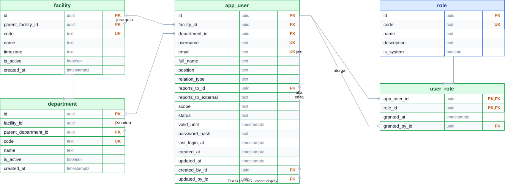
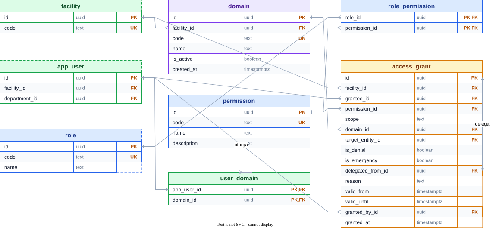

# Ingeniería: diagrama de la base de datos v0

Estado: borrador en construcción por fases (issue #58). El diagrama es un
**`.drawio`** con un SVG exportado por vista (ADR-0017,
`ingenieria/DIAGRAMAS.md`); este documento es el **registro de decisiones**, la **matriz de clases** y la **trazabilidad
regla→constraint** que pide el brief. Nada entra al diagrama sin su ficha aquí:
cero tablas "porque sí".

Raíz **Instalación**, single-company (ADR-0014). Sin tabla `empresa`.

## 0. Convenciones (Fase 0)

### 0.1 Mapa de almacenes — qué cuenta como "dato"

DOCU guarda datos en más de un lugar; todos entran al modelo.

| Almacén | Qué guarda | Tecnología | En v0 |
|---|---|---|---|
| Relacional | verdad, config, historial, auditoría, dominio | PostgreSQL 18 | sí |
| Vectorial | memoria semántica / embeddings | pgvector `vector(768)` | sí |
| Objetos | bytes de los originales (nunca se borran) | FS local; la ruta vive en la BD | sí |
| Cola | trabajo asíncrono (parseo, OCR, embeddings) | Redis/BullMQ | sí (estado, no fuente) |
| OCR | texto y hallazgos derivados del original | tabla derivada | sí |
| Engram | memoria del agente y de la plataforma | servicio externo | sí (referencia desde la BD) |

### 0.2 Esquemas (separación)

| Esquema | Responsabilidad |
|---|---|
| `core` | acceso y organización (instalación, departamento, usuario, rol) |
| `ingest` | archivos, parseo, OCR, cuarentena |
| `graph` | dominio genérico (tipos, entidades, relaciones) |
| `truth` | verdad histórica y auditoría (historial de origen, bitácora) |
| `config` | configuración y reglas como datos (familias, reglas) |
| `platform` | datos de plataforma (embeddings, jobs, sesiones, Engram) |

Nada vive en `public`.

### 0.3 Clases de dato

Etiqueta obligatoria por tabla:

- **fija** — catálogo sembrado del motor, igual en toda instalación; se extiende por `INSERT`, no por código.
- **cargable** — la define la empresa (instalación): se carga como dato, no requiere código.
- **dinámica** — depende de la instalación y de lo consumido.
- **manual** — la agrega o la cierra una persona (confirmaciones, motivos, decisiones, grants).
- **append-only** — nunca `UPDATE` ni `DELETE`; la garantía se exige en la base (triggers o permisos INSERT-only), se implementa en M1.

### 0.4 Fijo vs cargable (regla)

Pregunta: *¿una compañía razonable necesitaría otro valor?*

| Si es… | Se guarda como | Ejemplos |
|---|---|---|
| Vocabulario del motor que no cambia | **`CHECK`** en la columna | `status`, `scope`, `relation_type`, estados de archivo/cuarentena |
| Catálogo del motor que hay que listar/traducir/versionar | **tabla sembrada** (`is_system`) | `role`, `permission`, severidades |
| Forma de la empresa | **tabla cargable** | `facility`, `department`, `domain`, `family_config`, `validation_rule`, `entity_type`, turnos, umbrales |

Regla corta: **vocabulario del motor → fijo; forma de la empresa → cargable.** Los
fijos van como `CHECK`, no como tipo `enum` nativo de Postgres.

### 0.5 Nombrado y tipos

- Tablas y columnas en `snake_case` singular; PK `id uuid`; FK `<tabla>_id`; fechas `*_at timestamptz` / `*_on date`; booleanos `is_*`.
- Enums por `CHECK`, no tipo nativo.
- Tipos permitidos (STACK §2.4): `uuid`, `text`, `bigint`, `timestamptz`, `date`, `jsonb`, `vector(768)`. `NULL` solo con motivo escrito.
- Inglés en el schema; español en este documento.

### 0.6 Glosario es ↔ en

| Español | English | Esquema |
|---|---|---|
| Instalación | `facility` | core |
| Departamento | `department` | core |
| Usuario | `app_user` | core |
| Rol | `role` | core |
| Permiso | `permission` | core |
| Rol↔Permiso | `role_permission` | core |
| Dominio / sección | `domain` | core |
| Usuario↔Dominio | `user_domain` | core |
| Grant / delegación / denegación | `access_grant` | core |
| Archivo original | `source_file` | ingest |
| Registro crudo | `parsed_record` | ingest |
| Cuarentena | `quarantine` | ingest |
| Resultado OCR | `ocr_result` | ingest |
| Tipo de entidad | `entity_type` | graph |
| Entidad | `entity` | graph |
| Relación | `relation` | graph |
| Historial de origen | `origin_history` | truth |
| Bitácora | `audit_log` | truth |
| Config de familia | `family_config` | config |
| Regla de validación | `validation_rule` | config |
| Memoria (vector) | `memory_embedding` | platform |
| Ejecución de job | `job_run` | platform |
| Sesión | `session` | platform |
| Referencia a Engram | `engram_ref` | platform |

### 0.7 Plantilla de ficha de tabla

```
### <tabla> (<español>) — clase: <clase> — esquema: <esquema>
Porqué: <una frase: qué verdad sostiene>
| Campo | Tipo | Nulo | Constraint / Default | Porqué |
Conexiones: <FK entrantes / salientes>
Reglas: <R-P1..T1, RF/RNF>
Índices: <cuáles y para qué consulta>
```

## El diagrama (una vista por área)

Hoy solo el área `core` (Fase 1); el resto (`ingest`, `graph`, `truth`, `config`,
`platform`) se añade en sus fases. El diagrama es el **mapa**: entidades y las **22
FKs**, en dos vistas para que se lea. Los campos, tipos, nullabilidad y constraints
viven en las fichas de la Fase 1 (abajo), que es donde se leen sin ruido.

> La fuente es [`DIAGRAMA-BD-v0.drawio`](DIAGRAMA-BD-v0.drawio): se edita en
> draw.io / diagrams.net y se exporta a SVG. GitHub no renderiza `.drawio`, por eso
> el SVG vive al lado y es lo que se embebe. Al cambiar el diagrama se re-exporta
> la página correspondiente (`bun run diagramas:drawio`) y se sobreescribe su SVG.
>
> SHA-256 de la fuente: `5221c3e754e10f4ee547045135c7fab2bafd1e0b2d5cdcf1afb500e4a5fbe3a2`
>
> Esa huella es lo que hace trazable el diagrama: `bun run diagramas:check` la
> recalcula y falla si el `.drawio` cambió sin que este texto se actualice, y
> además comprueba que cada tabla del diagrama esté en la matriz de clases de más
> abajo. Editar el diagrama obliga a editar su texto: no se desincronizan solos.

Cada tabla es una **tabla nativa de draw.io** (`shape=table` con filas y celdas
`shape=tableRow` / `shape=partialRectangle`), no cajas dibujadas a mano: se
redimensiona, se le añaden filas y se edita cada celda con las herramientas
normales. Tres columnas por fila: **campo · tipo · clave** (`PK`, `FK`, `UK`);
el encabezado lleva el nombre de la tabla y el color de su clase (§0.3). Las
relaciones son aristas ER nativas (`ERone` / `ERmany`) del campo que apunta al
campo referido.

### 1a — Organización (identidad y jerarquía)



Página `1a` del `.drawio`. Incluye todos los campos de las cinco tablas.

### 1b — Autorización (lo específico)



Página `1b` del `.drawio`. `facility`, `app_user` y `role` aparecen punteados
como contexto de la página 1a.

## Matriz de clases

| Tabla | Clase | Esquema |
|---|---|---|
| `facility` | dinámica | core |
| `department` | dinámica | core |
| `app_user` | dinámica | core |
| `role` | fija | core |
| `user_role` | dinámica | core |
| `permission` | fija | core |
| `role_permission` | fija | core |
| `domain` | cargable | core |
| `user_domain` | dinámica | core |
| `access_grant` | manual | core |

## Fase 1 — Identidad, organización y autorización (`core`)

### 1a — Identidad y organización

`facility 1─* department 1─* app_user *─* role` (vía `user_role`); ambas
jerarquías son auto-referentes (`parent_*`, `reports_to_id`).

**facility (Instalación)** — clase: dinámica · *Porqué:* la raíz; toda tabla
dinámica cuelga de aquí (aislamiento RF-06); jerarquía organización → instalación
(`CORP` → `C1`).

| Campo | Tipo | Nulo | Constraint / Default | Porqué |
|---|---|---|---|---|
| `id` | uuid | no | PK | clave opaca |
| `parent_facility_id` | uuid | sí | FK `facility(id)` | jerarquía `CORP`→`C1`; nula en la raíz |
| `code` | text | no | UNIQUE | `C1`, `CORP` |
| `name` | text | no | | |
| `timezone` | text | no | default `'America/Mexico_City'` | turnos/fechas locales |
| `is_active` | boolean | no | default `true` | baja lógica |
| `created_at` | timestamptz | no | default `now()` | |

**department (Departamento)** — clase: dinámica · *Porqué:* organigrama en árbol;
agrupa usuarios y es base de permisos.

| Campo | Tipo | Nulo | Constraint / Default | Porqué |
|---|---|---|---|---|
| `id` | uuid | no | PK | |
| `facility_id` | uuid | no | FK `facility(id)` | aislamiento |
| `parent_department_id` | uuid | sí | FK `department(id)` | jerarquía del organigrama |
| `code` | text | no | UNIQUE(`facility_id`,`code`) | `planeacion`, `almacen`… |
| `name` | text | no | | |
| `is_active` | boolean | no | default `true` | |
| `created_at` | timestamptz | no | default `now()` | |

**app_user (Usuario)** — clase: dinámica · *Porqué:* identidad de quien actúa
(alta, sesión, movimientos). **Sin permisos dentro.** No se llama `user` porque es
palabra reservada de Postgres.

| Campo | Tipo | Nulo | Constraint / Default | Porqué |
|---|---|---|---|---|
| `id` | uuid | no | PK | |
| `facility_id` | uuid | no | FK `facility(id)` | adscripción (no jefatura) |
| `department_id` | uuid | sí | FK `department(id)` | corporativo/admin puede no tener depto |
| `username` | text | no | UNIQUE(`facility_id`,`username`) | login legible (`c1.mantenimiento.juan`) |
| `email` | text | no | UNIQUE(`facility_id`,`email`) | |
| `full_name` | text | no | | |
| `position` | text | no | | puesto, texto libre |
| `relation_type` | text | no | CHECK `interno|externo`, default `interno` | interno/externo |
| `reports_to_id` | uuid | sí | FK `app_user(id)` | jefe dentro del sistema |
| `reports_to_external` | text | sí | | jefe fuera (texto): Elena→VP RH |
| `scope` | text | no | CHECK `organizacion|instalacion|departamento|propio` | alcance por defecto |
| `status` | text | no | CHECK `activo|suspendido|baja`, default `activo` | |
| `valid_until` | timestamptz | sí | CHECK: externo ⇒ NOT NULL | vigencia obligatoria para externos |
| `password_hash` | text | sí | | nulo si auth externa |
| `last_login_at` | timestamptz | sí | | último acceso |
| `created_at` / `updated_at` | timestamptz | no | default `now()` | |
| `created_by_id` / `updated_by_id` | uuid | sí | FK `app_user(id)` | quién dio de alta / tocó |

**role (Rol)** — clase: fija · *Porqué:* catálogo sembrado del motor.
`code` UNIQUE CHECK `admin|manager|member|guest`; `name`; `description`;
`is_system` (rol del motor, no editable por la empresa).

**user_role (UsuarioRol)** — clase: dinámica · *Porqué:* qué rol tiene cada
usuario y quién lo otorgó. Marca el rol, **no** los permisos.
`(app_user_id, role_id)` PK; `granted_at`; `granted_by_id`.

### 1b — Autorización

`permission` (fija) ← `role_permission` (base) y ← `access_grant` (lo específico).
`domain` (cargable) ← `user_domain` (defecto) y ← `access_grant`.

**permission (Permiso)** — clase: fija · *Porqué:* catálogo de las 12 acciones del
motor; vocabulario fijo, nunca dentro de `app_user`.
`code` UNIQUE — `read, download, create, update, submit, confirm, release,
quarantine, manage_users, manage_permissions, manage_config, view_audit`; `name`;
`description`.

**role_permission (Rol↔Permiso)** — clase: fija · *Porqué:* capacidades base de
cada rol; lo que comparten todos los de ese rol. `(role_id, permission_id)` PK.

**domain (Dominio)** — clase: cargable · *Porqué:* las secciones que ve cada quien
(`planeacion`, `almacen`…); cada instalación trae las suyas sin código.
`facility_id` FK; `code` UNIQUE(`facility_id`,`code`); `name`; `is_active`;
`created_at`.

**user_domain (Usuario↔Dominio)** — clase: dinámica · *Porqué:* dominios por
defecto de un usuario. `(app_user_id, domain_id)` PK.

**access_grant (Grant / delegación / denegación)** — clase: manual · *Porqué:* lo
específico —qué puede hacer un usuario concreto sobre algo concreto, con vigencia,
motivo y otorgante (ROLES §13/§14). **Sin fin no hay grant.**

| Campo | Tipo | Nulo | Constraint / Default | Porqué |
|---|---|---|---|---|
| `id` | uuid | no | PK | |
| `facility_id` | uuid | no | FK `facility(id)` | aislamiento |
| `grantee_id` | uuid | no | FK `app_user(id)` | a quién |
| `permission_id` | uuid | no | FK `permission(id)` | qué acción |
| `scope` | text | no | CHECK `organizacion|instalacion|departamento|propio` | alcance |
| `domain_id` | uuid | sí | FK `domain(id)` | sobre qué sección; nulo = toda la instalación |
| `target_entity_id` | uuid | sí | FK `entity(id)` (Fase 3) | el "algo específico" |
| `is_denial` | boolean | no | default `false` | bloqueo explícito; gana sobre todo |
| `is_emergency` | boolean | no | default `false` | break-glass (§14) |
| `delegated_from_id` | uuid | sí | FK `app_user(id)` | suplencia (§13) |
| `reason` | text | no | | motivo obligatorio |
| `valid_from` | timestamptz | no | default `now()` | |
| `valid_until` | timestamptz | no | CHECK > `valid_from` | obligatorio |
| `granted_by_id` | uuid | no | FK `app_user(id)` | quién lo otorgó |
| `granted_at` | timestamptz | no | default `now()` | |

**Permiso efectivo** (lo calcula el motor de #5, no el schema):
`role_permission` (base) **+** `access_grant` **−** denegaciones, con alcance,
dominio, objetivo y vigencia.

**Índices (Fase 1):** `facility(code)`; `department(facility_id, code)`;
`app_user(facility_id, username)` y `(facility_id, email)`; `app_user(department_id)`;
`app_user(reports_to_id)`; `domain(facility_id, code)`; `access_grant(grantee_id,
permission_id)`; PK compuestas en `user_role`, `role_permission`, `user_domain`.

## Trazabilidad regla → constraint

| Regla | Estructura que la sostiene | Estado |
|---|---|---|
| RF-06 aislamiento por instalación | `facility_id NOT NULL` + FK en toda tabla dinámica; unique compuesto lo incluye | Fase 1 |
| RNF-03 roles y permisos | `role` + `permission` (fijos) + `user_role` (base) + `access_grant` (específico) | Fase 1 |
| R-Q1 solo calidad libera | `access_grant` con `permission=release` + `entity.confirmed_by_id` | Fase 1 y 3 |
| Externos con vigencia (§2, §12) | CHECK `externo ⇒ valid_until NOT NULL` | Fase 1 |
| Nadie otorga más de lo que tiene (§3) | `access_grant.granted_by_id` + validación en el motor (#5) | Fase 1 (motor #5) |
| R-P1/P2/P3/T1 | `validation_rule` → `quarantine` | Fase 2 y 5 |
| Historia que no se reescribe | append-only (triggers/permisos) en `source_file`, `origin_history`, `audit_log` | Fase 2, 4 y 6 |
