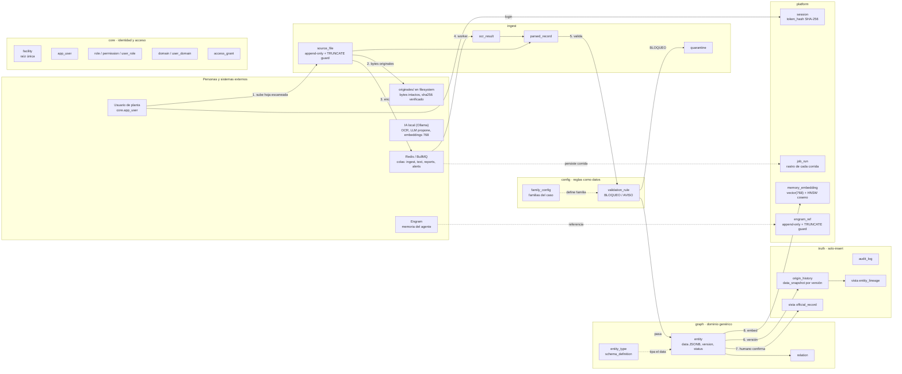

# Ingeniería: inventario total de la base de datos (ER v1)

Estado: retrato de cierre del carril #58 al 2026-11-07, con la adopción de la
auditoría externa (aislamiento por instalación, TRUNCATE, snapshot histórico y
confirmación completa). Rama `feat/58-diagrama-v0` en PR #107, **sin fusionar**.
Este documento describe **lo que existe hoy**, no lo que se planea: lo planeado
va en ADRs e issues.

Fuentes de verdad, en orden:

1. `apps/api/prisma/schema.prisma` — el modelo Prisma (658 líneas, 25 modelos).
2. `apps/api/prisma/migrations/0_baseline/migration.sql` — el DDL real (930 líneas).
3. `apps/api/scripts/schema-test.ts` — las pruebas que fijan el contrato (ver §8).
4. La base viva `docu-db-58`, verificada con `psql` el 2026-11-07.

## 0. Panorama unificado: todo lo que toca datos

Una sola vista con **todos** los elementos de datos: tablas por esquema, las
dos vistas, los triggers append-only, el vector y sus índices, y los sistemas
externos (filesystem, Redis, IA local, Engram). El recorrido es el caso real:
una hoja escaneada entra, se valida, se propone y un humano la confirma.

Todo lo que cruza de un esquema a otro pasa por FK compuestas
`(facility_id, id)` (ADR-0019); las cuatro tablas marcadas append-only están
blindadas con triggers por fila **y** por `TRUNCATE`.

## 1. Dónde vive la base

| Pieza | Valor real |
|---|---|
| Imagen | `pgvector/pgvector:pg18` (PostgreSQL 18) |
| Contenedor | `docu-db-58`, puerto `5434` |
| Base | `docu`, usuario y credenciales en `.env` (nunca aquí) |
| Colas | `docu-redis-58` (Redis 8, puerto `6381`), no almacena datos de negocio |
| Migraciones | una sola, `0_baseline`, con `CREATE EXTENSION IF NOT EXISTS vector` |
| Config Prisma | `apps/api/prisma.config.ts`, lee `DATABASE_URL` del `.env` de la raíz (ADR-0004) |

La extensión `vector` (0.8.7) la crea la migración baseline, no un script de
arranque: `infra/postgres/init` sigue vacío a propósito.

## 2. Los 6 esquemas y sus 25 tablas

El modelo no tiene tablas por entidad de negocio: el dominio es **híbrido**
(todo dato vive en `graph.entity` + `graph.entity_type` + `graph.relation`)
y las reglas son **datos** (`config.validation_rule`). Este es el corazón
del ER v1 y lo que formalizará el ADR-0019 (reservado, ver §9).

| Esquema | Tabla | Papel |
|---|---|---|
| `core` | `facility` | Raíz única de la instalación (single-company, ADR-0014) |
| `core` | `department` | Departamentos de la instalación |
| `core` | `app_user` | Usuarios; `password_hash` (login con token opaco, ADR-0021) |
| `core` | `role` | RBAC: `admin`, `manager`, `member`, `guest` |
| `core` | `user_role` | Puente usuario-rol |
| `core` | `permission` | Permiso fino del sistema |
| `core` | `role_permission` | Puente rol-permiso |
| `core` | `domain` | Dominio de negocio (área temática) |
| `core` | `user_domain` | Alcance de dominio por usuario; `facility_id` + FK compuestas (misma instalación) |
| `core` | `access_grant` | Concesión puntual: `scope`, `target_entity_id` (FK a `graph.entity`), denegación, emergencia, delegación, vigencia |
| `ingest` | `source_file` | Archivo original; `sha256` único; **solo-insert** |
| `ingest` | `parsed_record` | Registro extraído de un archivo (con `record_index`) |
| `ingest` | `quarantine` | Cuarentena con motivo y regla que la disparó |
| `ingest` | `ocr_result` | Salida del OCR de un archivo |
| `graph` | `entity_type` | Tipo canónico de entidad (vocabulario del caso) |
| `graph` | `entity` | La entidad: `data` JSONB, `version`, `status` (`proposed` → `official`), confirmación humana |
| `graph` | `relation` | Relación dirigida entre entidades |
| `truth` | `origin_history` | De dónde salió cada valor y versión; **solo-insert** |
| `truth` | `audit_log` | Bitácora de acciones; **solo-insert** |
| `config` | `family_config` | Familia documental (las 6 del caso; nuevas familias = filas, no código) |
| `config` | `validation_rule` | Regla como dato: `applies_to`, expresión JSON, severidad `BLOQUEO`/`AVISO` (ADR-0009) |
| `platform` | `session` | Sesión con `token_hash` SHA-256 único, expiración y revocación (ADR-0021) |
| `platform` | `memory_embedding` | Embedding `vector(768)` por entidad/archivo (ver §5) |
| `platform` | `job_run` | Persistencia de corridas de cola: `ingest`, `text`, `reports`, `alerts` (ADR-0011) |
| `platform` | `engram_ref` | Referencia a memoria del agente; **solo-insert** |

CHECK de negocio relevantes (20 en total, contados por las pruebas): estados
de cuarentena, severidad de regla, cola y estado de `job_run`
(`expires_at > issued_at` en sesión), y el bloque de confirmación oficial:
una entidad `official` exige `confirmed_by_id` **y** `confirmed_at`, con
fecha siempre que haya responsable y sin confirmación prematura en
borradores (IA propone, humano dispone).

Aislamiento por instalación (ADR-0019): toda FK entre dos tablas con
instalación es compuesta — `UNIQUE (facility_id, id)` en el padre y
`FOREIGN KEY (facility_id, otro_id) REFERENCES padre(facility_id, id)` —, así
que cruzar instalaciones revienta con `foreign_key_violation` aunque el
código se equivoque. Las FK simples que quedan son las globales (`facility`,
`role`, `permission`) y las de atribución (`created_by_id`, `confirmed_by_id`,
`actor_id`, etc.), que registran quién hizo algo pero no dan acceso a datos.

## 3. Las 2 vistas: el contrato de salida del dato

| Vista | Qué entrega |
|---|---|
| `truth.official_record` | Toda entidad con `status = 'official'`, ya unida con su tipo y el responsable que la confirmó (`confirmed_by_username`, `confirmed_by_name`, `confirmed_at`). Es la fuente de la pantalla Reporte/Búsqueda |
| `truth.entity_lineage` | El encadenamiento completo de una entidad: cada versión con el **snapshot del valor publicado** (`data_snapshot`), la regla que la validó, el archivo de origen (`original_name`, `sha256`) y el registro parseado del que salió. Es la trazabilidad consultable y permite reconstruir qué se publicó y cuándo |

Nada escribe contra las vistas: son lectura. La escritura entra por
`graph.entity` / `truth.origin_history`.

## 4. Triggers: la base garantiza el solo-insert

Una función y ocho triggers, en el propio DDL (ADR-0010: "una corrección es
una fila nueva, nunca una edición"):

- Función `core.reject_mutation()`: lanza error `restrict_violation` con
  mensaje explícito sobre ADR-0010.
- Triggers `BEFORE UPDATE OR DELETE` (por fila) sobre: `ingest.source_file`,
  `truth.origin_history`, `truth.audit_log`, `platform.engram_ref`.
- Triggers `BEFORE TRUNCATE` (por statement) sobre las mismas cuatro tablas:
  los triggers por fila no se disparan con `TRUNCATE`, y sin esta guardia un
  `TRUNCATE` vaciaría la historia sin tocar un solo trigger (auditoría
  2026-11-07). Las pruebas aceptan dos bloqueos válidos: el trigger o una FK
  referenciante.

La función vive en `core` porque todos los esquemas dependen de `core`.

## 5. Vectores: pgvector y la búsqueda semántica

- Columna `platform.memory_embedding.embedding`: `vector(768)`, opcional.
  Prisma la declara como `Unsupported("vector(768)")`: el vector lo escribe el
  worker, no el cliente (ADR-0004).
- Índice: HNSW con distancia coseno
  (`memory_embedding_embedding_hnsw_idx ... USING hnsw ("embedding" vector_cosine_ops)`).
- **768 es contrato de `docs/ingenieria/IA.md` §6**: tiene que coincidir con el
  modelo de embeddings elegido (candidatos con salida MRL a 768:
  `nomic-embed-text` v1.5, EmbeddingGemma). Cambiarlo después de producción
  exige migrar los vectores existentes, así que se fija antes.
- Prioridad MoSCoW: la búsqueda léxica (`tsvector`) es Must y va primero; la
  semántica por embedding es Should. El índice HNSW ya está, el semáforo lo
  marca como "listo para cuando se encienda".

## 6. La IA sobre la base

El pipeline no mete lógica de IA en la API (ADR-0011):

1. La API encola trabajo en Redis (`ingest`, `text`, `reports`, `alerts`).
2. El worker procesa y **propone**: parsea, aplica reglas y propone entidades
   en `graph.entity` con `status = 'proposed'` (ADR-0006).
3. Las reglas no son código: se leen de `config.validation_rule`
   (`applies_to` por familia), y su severidad decide cuarentena
   (`BLOQUEO`) o aviso (`AVISO`) — ADR-0009.
4. El humano confirma: la entidad pasa a `official` con `confirmed_by_id`
   (CHECK en la base lo obliga) y eso alimenta `truth.official_record`.
5. `platform.job_run` deja rastro de cada corrida de cola; `truth.audit_log`
   deja rastro de cada acción.

La elección de motores de IA (cuál modelo, con qué parámetros) será
**configuración, no código**: es el ADR-0020, reservado para el issue #85.

## 7. Decisiones que sostienen esta base

| ADR | Qué fija para la BD |
|---|---|
| [0004](../decisiones/ADR-0004-prisma-postgresql-pgvector.md) | Prisma 7 con driver adapter sobre PG18 + pgvector |
| [0006](../decisiones/ADR-0006-ia-propone-humano-dispone.md) | Ninguna publicación sin confirmación humana (CHECK de `confirmed_by_id`) |
| [0009](../decisiones/ADR-0009-reglas-del-caso-como-datos.md) | Reglas como filas en `config.validation_rule` |
| [0010](../decisiones/ADR-0010-bitacora-e-historial-solo-insert.md) | Solo-insert garantizado por triggers, no solo por código |
| [0011](../decisiones/ADR-0011-api-encola-worker-procesa.md) | La API encola; el worker procesa y propone |
| [0014](../decisiones/ADR-0014-instalacion-single-company.md) | Raíz `facility` única, sin multi-tenant |
| [0017](../decisiones/ADR-0017-drawio-para-el-er.md) | El ER se dibuja en draw.io y vive en el repo |
| [0018](../decisiones/ADR-0018-sdd-y-tdd-como-metodo-de-trabajo.md) | El DDL tiene pruebas que lo fijan (SDD/TDD) |
| [0019](../decisiones/ADR-0019-dominio-hibrido-del-er.md) | Dominio híbrido con aislamiento por instalación garantizado por FK compuestas, snapshot histórico y confirmación completa |
| [0021](../decisiones/ADR-0021-token-opaco-con-revocacion-inmediata.md) | Sesión con token opaco hasheado en `platform.session` |
| [0022](../decisiones/ADR-0022-paginacion-por-limit-y-offset.md) | Listas con `limit`/`offset`, array plano, `X-Total-Count` |

Reservado (aún sin escribir): **0020** motores de IA como configuración (#85).

## 8. Cómo se verifica todo lo anterior

`bun run db:test` (desde `apps/api`) aplica la migración a una base scratch y
corre las pruebas SQL. Estado al 2026-11-07 (con auditoría adoptada): **verde**.

- Contrato estructural: 25 tablas, 2 vistas, 20 CHECK, 8 triggers
  solo-insert (4 por fila + 4 TRUNCATE), extensión `vector`, índice HNSW.
- `solo_insert.sql`: las 4 tablas blindadas rechazan UPDATE, DELETE y TRUNCATE.
- `new_family.sql`: una familia nueva se declara como dato y se enlaza con su
  regla; el CHECK de confirmación rechaza un oficial sin responsable y acepta
  uno con confirmación humana.
- `isolation.sql`: 14 cruces entre instalaciones rechazadas con
  `foreign_key_violation`; oficial con responsable y sin fecha rechazado;
  borrador con confirmación prematura rechazado; el snapshot de la versión 1
  sobrevive a la publicación de la versión 2 y `entity_lineage` lo expone.
- La base scratch se conserva a propósito (`docu_schema_test_*`); el script
  nunca borra nada.

La base viva `docu-db-58` coincide 1:1 con este inventario y hoy tiene
**0 filas**: el esquema está aplicado, aún no hay datos de la instalación.

## 9. Alcance: qué está hecho y qué falta

Hecho en esta rama (PR #107, sin fusionar):

- `schema.prisma` completo: 25 modelos, 6 esquemas, FK compuestas por instalación.
- Migración baseline: esquemas, tablas, FK compuestas, CHECK (incluida la
  confirmación completa), índices, HNSW, vistas, función, 8 triggers
  (4 por fila + 4 TRUNCATE) y `origin_history.data_snapshot`.
- Aislamiento por instalación probado: `tests/isolation.sql` (14 cruces
  rechazadas por la base, auditoría 2026-11-07 A-01).
- Protección TRUNCATE probada (A-02) y snapshot histórico verificado (A-04).
- `ADR-0019` redactado (dominio híbrido) como Propuesta: se acepta en el merge.
- Diagrama del ER en draw.io (`DIAGRAMA-BD-v0.drawio` + 7 SVGs) y texto
  derivado alineados.
- Pruebas SQL y `schema-test.ts` en verde.

Pendiente (orden real):

1. Revisión del PR #107 (Emmanuel revisa; la adopción de la auditoría está
   resumida en el issue #58).
2. Cargar datos: seeds de `config` (familias y reglas) y del caso C1.
3. Backend 12→18-nov (#12, #3, #46, #44, #5) sobre este contrato.
4. Pipeline IA 13→17-nov (#85) y su ADR-0020 (motores como configuración).
5. Embeddings reales: decidir el modelo y encender la escritura de
   `platform.memory_embedding` (el índice ya espera).
6. Fuera de #58 (no de este carril): separación de cuentas de BD
   (propietario de migraciones vs runtime), `TRUNCATE` revocado al usuario de
   aplicación y perfil de despliegue en planta.
