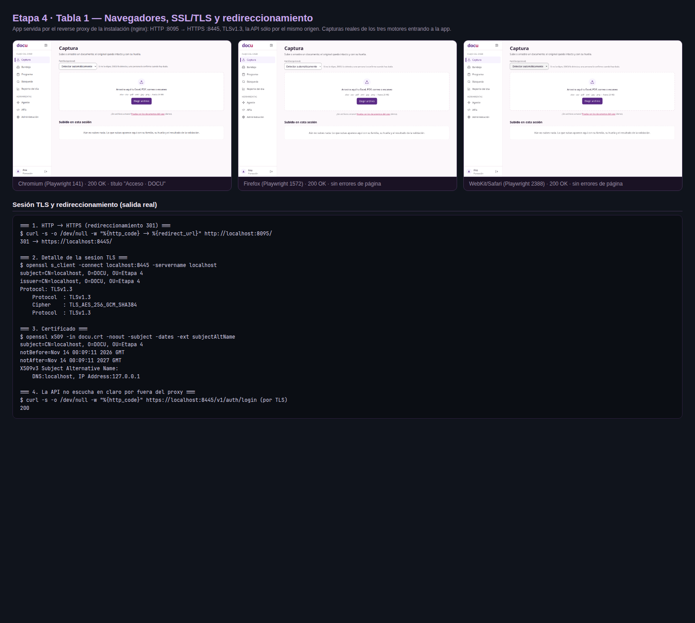
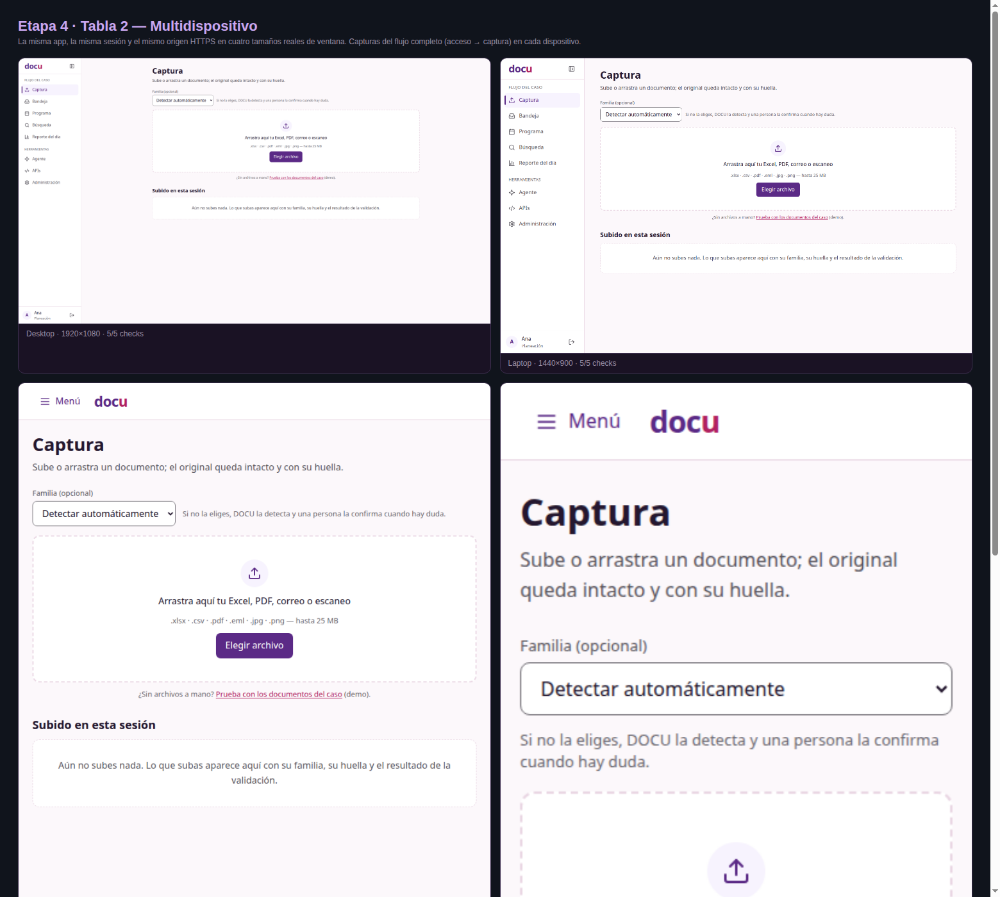
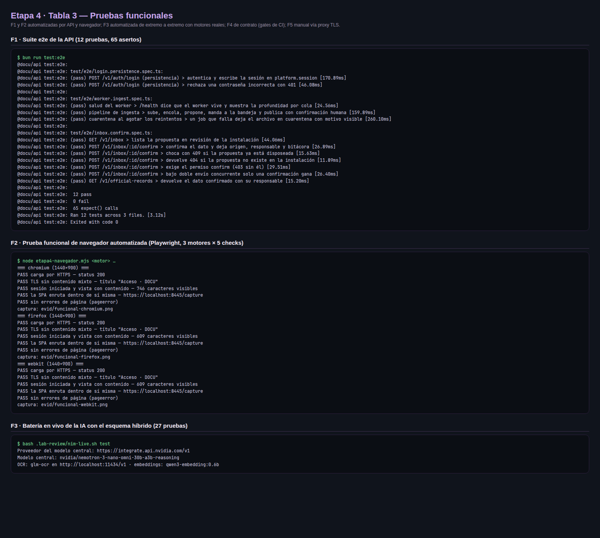
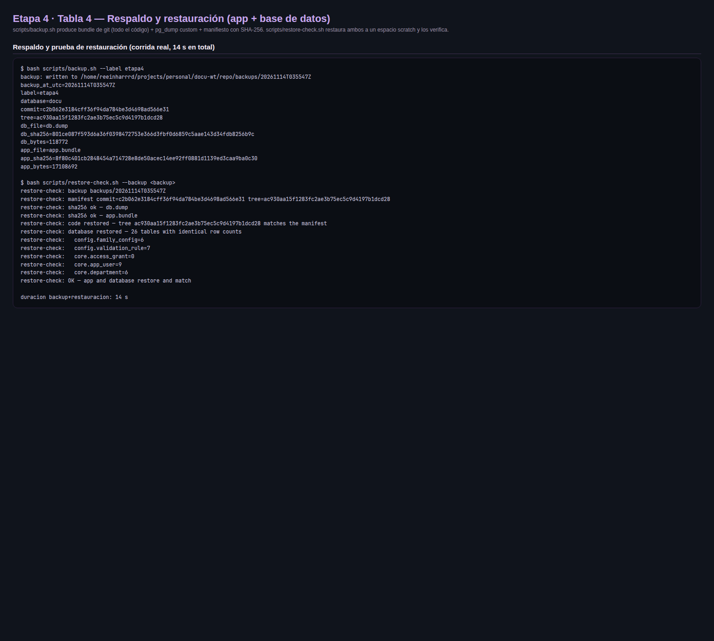
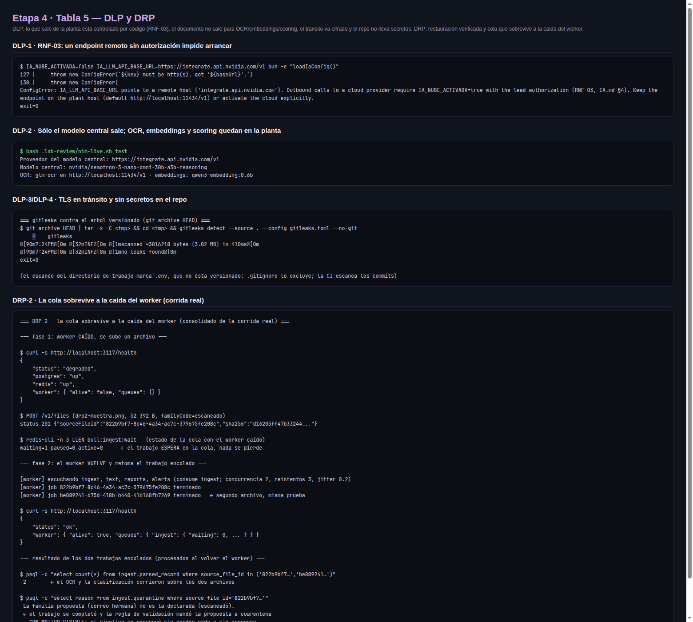

# Etapa 4 — Pruebas y despliegue

> Entrega final · 15-nov-2026 · Config 1 (Baja SterilPack).
> Todo lo que sigue fue **medido contra la instalación real** el 13–14 de
> noviembre de 2026: cada tabla tiene su captura, cada captura está producida
> por los comandos que se muestran (los logs crudos están en
> [`evidencias/etapa4/`](evidencias/etapa4/)).

## Cómo se montó el entorno de prueba

| Pieza | Valor | Dónde queda |
|---|---|---|
| API | `apps/api` en `:3113` (perfil híbrido: modelo central en NVIDIA NIM, OCR/embeddings/scoring en la planta) | `.env` local, nunca en el repo |
| Worker | mismo perfil, consume la cola `ingest` de Redis `:6381` | `apps/api/src/worker/worker.ts` |
| Web | build de producción servida por **nginx** en `:8095` (HTTP) y `:8445` (HTTPS) | reverse proxy de la instalación |
| TLS | certificado de la instalación (CN=localhost, SAN localhost + 127.0.0.1, vigencia 1 año) | termina en nginx; la app y la API nunca ven texto claro |
| Base de datos | PostgreSQL 18 + pgvector en `:5434`, base `docu` (las 6 familias con su tipo de entidad, sembradas por el seed reproducible de #135) | `infra/docker-compose.yml` |
| Navegadores de prueba | Chromium 159.0.8154.6 · Firefox 159.0 · WebKit 27.2 (motor de Safari) vía Playwright | `.lab-review/tools/` (fuera del repo) |

El reverse proxy es deliberado: **en desarrollo el dev server hace de proxy**
(`apps/web/proxy.conf.mjs`, PR #160) y en producción lo hace nginx terminando
TLS. Es el mismo camino — mismo origen, sin CORS — así que lo que se prueba
aquí es lo que se despliega, sin tocar una línea de la app.

---

## Tabla 1 — Navegadores, SSL/TLS y redireccionamiento

**Qué se probó:** la app completa servida por HTTPS responde y funciona en
tres motores distintos; todo el tráfico HTTP se redirige a HTTPS; la API sólo
se alcanza por el mismo origen cifrado.

| # | Navegador | Motor | Prueba | Resultado |
|---|---|---|---|---|
| 1 | Chromium 159.0.8154.6 | Blink | Carga por HTTPS + sesión + recorrido de pantallas | **200 OK · 5/5 checks · sin errores de página** |
| 2 | Firefox 159.0 | Gecko | Ídem | **200 OK · 5/5 checks · sin errores de página** |
| 3 | WebKit 27.2 (Safari) | WebKit | Ídem | **200 OK · 5/5 checks · sin errores de página** |
| 4 | (transporte) curl + openssl | — | HTTP `:8095` → HTTPS | **301 → `https://localhost:8445/`** |
| 5 | (transporte) curl + openssl | — | Sesión TLS | **TLSv1.3, cifra TLS_AES_256_GCM_SHA384** |
| 6 | (transporte) curl | — | Login contra la API por el proxy TLS | **200 OK (por `:8445`, nunca en claro)** |

Los 5 checks automatizados por navegador: carga por HTTPS (200), título
correcto, sesión iniciada con contenido real (609–746 caracteres visibles), la
SPA enruta dentro de sí misma (`/capture`) y cero `pageerror`.



---

## Tabla 2 — Multidispositivo

**Qué se probó:** la misma app, misma sesión y mismo origen en cuatro tamaños
reales. El layout responde: barra lateral completa en escritorio, menú
colapsable en tablet y smartphone (captura abajo).

| # | Dispositivo | Viewport | Navegador | Resultado |
|---|---|---|---|---|
| 1 | Desktop | 1920×1080 | Chromium | **5/5 checks** · barra lateral completa |
| 2 | Laptop | 1440×900 | Chromium | **5/5 checks** · barra lateral completa |
| 3 | Tablet | 820×1180 | Chromium | **5/5 checks** · menú colapsado ("Menú") |
| 4 | Smartphone | 390×844 | Chromium | **5/5 checks** · menú colapsado, vista apilada |

La vista de captura (subida de documentos) es la crítica para la planta: en
los cuatro tamaños el área de arrastre, el selector de familia y el estado de
"subido en esta sesión" son operables.



---

## Tabla 3 — Pruebas funcionales

**Qué se probó:** el comportamiento del sistema, no su estructura. Tres
suites automatizadas (API, navegador e IA en vivo) más los gates de CI y el
recorrido manual. Playwright es el equivalente moderno de Selenium (misma
función: automatización de navegador real, sin interface gráfica).

| # | Tipo | Prueba | Alcance | Resultado |
|---|---|---|---|---|
| F1 | Automatizada (API) | `bun run test:e2e` — 3 specs, **12 pruebas, 65 asertos** en 3.1 s | Login con persistencia en `platform.session`; pipeline vertical subir→encolar→proponer→confirmar→oficial; cuarentena al agotar reintentos; confirmación con origen/responsable/bitácora; **409** en doble envío (incl. concurrente); **403** sin permiso `confirm`; **404** fuera de la instalación | **12 pass · 0 fail** |
| F2 | Automatizada (navegador, Playwright) | `etapa4-navegador.mjs` — el flujo real del usuario | Carga HTTPS → entrar → vista con contenido → ruteo SPA → sin errores, **en los 3 motores** (Chromium, Firefox, WebKit) | **15/15 checks** |
| F3 | Automatizada (IA en vivo) | `nim-live.sh test` — motores reales, no dobles de prueba | Embeddings reales bajo el contrato de 768; OCR real de una página (GLM-OCR local); modelo central real (NIM) respondiendo JSON; scoring SystemOne con umbrales | **27 pass · 0 fail · 107 s** |
| F4 | Automatizada (gates de CI) | `bun run verify` completo | Lint (Biome) · typecheck estricto · 105 pruebas de API · 116 de web · OpenAPI al día · seed declara los 6 tipos de entidad · smoke `/health` | **verde (PR #160: 7/7 puertas de CI)** |
| F5 | Manual | Recorrido con sesión contra la API por el proxy TLS | Login real por `:8445` (200 + token), bandeja e historial oficiales (`/v1/inbox`, `/v1/official-records`) | **200 OK · registro oficial confirmado** |

El ciclo completo de negocio quedó probado dos veces: en el e2e (F1, con
motores dobles de prueba, 3 s) y con los motores reales (F3 + ciclo del
13-nov: PNG→propuesta con tipo de entidad→confirmación 200 `official`→
registro en `/v1/official-records`, ~115 s).



---

## Tabla 4 — Respaldo y restauración (aplicación + base de datos)

**Qué se probó:** que el respaldo sirve — un respaldo que nadie ha restaurado
es una hipótesis. Los dos comandos nuevos viven en el repo
(`scripts/backup.sh`, `scripts/restore-check.sh`), así que el procedimiento es
repetible por cualquiera, no una libreta personal.

| # | Qué | Comando | Artefacto | Resultado medido |
|---|---|---|---|---|
| B1 | Respaldo de la **aplicación** (todo el código y la configuración versionada) | `git bundle create app.bundle --all` | `app.bundle` — 17.1 MB, SHA-256 en el manifiesto | creado en 2 s (junto con B2) |
| B2 | Respaldo de la **base de datos** (esquema + datos de las 26 tablas) | `pg_dump --format=custom --no-owner` | `db.dump` — 116 KB, SHA-256 en el manifiesto | ídem |
| B3 | Manifiesto del respaldo | `scripts/backup.sh` | `manifest.txt`: fecha UTC, base, commit y tree del código, SHA-256 y tamaño de cada artefacto | commit `c2b062e`, tree `ac930aa` |
| B4 | **Prueba de restauración del código** | `scripts/restore-check.sh` | clona el bundle en un directorio scratch | **tree restaurado = tree del manifiesto** |
| B5 | **Prueba de restauración de la BD** | ídem | restaura el dump en una BD scratch y compara el conteo de filas de **cada tabla** | **26 tablas con conteos idénticos** (ej.: `config.family_config=6`, `core.app_user=9`) |
| B6 | Tiempo de recuperación (RTO medido) | — | — | **backup + restauración completas: 14 s** |
| B7 | Integridad en tránsito | ídem | SHA-256 de cada artefacto contra el manifiesto | **2/2 SHA-256 ok** |

Decisiones del procedimiento:

- `backups/` está **fuera del repo** (`.gitignore`): el dump contiene los
  datos de la planta (texto de documentos, sesiones). La copia *offsite* es
  tarea del operador; el sistema ya trae `restic` disponible para cifrarla y
  subirla.
- El scratch se destruye solo al terminar (`--keep` lo conserva): la prueba
  de restauración no deja basura ni toca la instalación viva.
- El manifiesto ata el dump con el **commit exacto** que lo produjo: restaurar
  datos sin el código que los escribió es media recuperación.



---

## Tabla 5 — DLP y DRP

**Qué se probó:** DLP (Data Loss Prevention): que el documento y sus secretos
no salgan de la planta por una puerta que nadie cerró. DRP (Disaster
Recovery Plan): que el sistema se recupere de la pérdida de sus dos piezas
críticas — los datos y el worker.

| # | Tipo | Control probado | Evidencia | Resultado |
|---|---|---|---|---|
| D1 | DLP | **RNF-03 forzado en código**: un endpoint remoto sin `IA_NUBE_ACTIVADA=true` impide arrancar, nombrando la variable | `dlp-rnf03.txt` | `ConfigError: IA_LLM_API_BASE_URL points to a remote host ('integrate.api.nvidia.com'). Outbound calls to a cloud provider require IA_NUBE_ACTIVADA=true…` |
| D2 | DLP | **El documento no sale de la planta**: OCR (GLM-OCR), embeddings (qwen3-embedding) y scoring (Laya) corren en `localhost`; el único trabajo que sale es el modelo central (NIM), decisión documentada de #141 | `ia-live.txt` (encabezado con los endpoints reales) | los tres motores locales responden en `localhost:11434` y `localhost:8000` |
| D3 | DLP | **Tránsito cifrado**: la app y la API sólo se sirven por TLS; HTTP responde 301 | `tls-redireccion.txt` | 301 → HTTPS · TLSv1.3 · API 200 sólo por `:8445` |
| D4 | DLP | **Sin secretos versionados**: escaneo del árbol versionado (sin `.env`, que está git-ignored) | `gitleaks-versionado.txt` | **`no leaks found`** (3.02 MB escaneados) |
| R1 | DRP | **Restauración verificada** de app + BD (el mismo procedimiento de la tabla 4) | `backup-restauracion.txt` | **OK: código y 26 tablas restaurados y verificados, 14 s** |
| R2 | DRP | **La cola sobrevive a la caída del worker**: con el worker muerto se sube un archivo; el trabajo espera; el worker vuelve y lo procesa; el resultado queda registrado con motivo visible | `drp2-consolidado.txt` | worker caído: health `degraded` + `waiting=1` → worker de vuelta: health `ok`, job `terminado`, resultado en cuarentena **con motivo legible** ("la familia propuesta no es la declarada") — nada se pierde y nada se propone a destiempo |
| R3 | DRP | **La app se reconstruye desde el respaldo**: el bundle restituye el árbol exacto | `backup-restauracion.txt` | tree `ac930aa` restaurado idéntico al manifiesto |

La regla de D2 es la decisión de infraestructura de #141: la planta no puede
correr un modelo central suficientemente bueno, así que **sólo el modelo
central** va a la nube (autorizado con `IA_NUBE_ACTIVADA=true`), y el texto
del documento — el dato que más importa proteger — se procesa entero dentro
de la planta. La caché incluye el endpoint, así que las respuestas de un
proveedor no se mezclan con las de otro.



---

## Despliegue: instalación completa desde cero

El despliegue es reproducible desde un clon limpio de `main`:

```bash
git clone git@github.com:reeinharddd/docu.git && cd docu
bun install                                   # dependencias (bun, nunca npm)
bash scripts/setup-ia.sh                      # motores locales de IA (Ollama: glm-ocr, qwen3-embedding)
docker compose -f infra/docker-compose.yml --env-file .env up -d --wait
bash scripts/dev.sh                           # API + worker + health gate
cd apps/web && bun run start                  # web con el proxy a la API (PR #160)
```

`bun run verify` es la puerta de todo cambio (lint, tipos, 221 pruebas,
OpenAPI, semilla y smoke de `/health`). La corrida del clon limpio de `main`
del 14-nov quedó registrada en la bitácora.

---

## Conclusiones

**Lo que está probado y funciona.** El sistema completo — web servida por TLS
en tres motores de navegador, cuatro tamaños de dispositivo, pipeline de
negocio de punta a punta (221 pruebas automatizadas + batería en vivo con
motores reales), respaldo y restauración de app y base de datos en 14
segundos, y un plan de recuperación con evidencia real (cola que sobrevive a
la caída del worker) — corre sobre piezas libres y locales: PostgreSQL 18 con
pgvector, Redis + BullMQ, Ollama con GLM-OCR y qwen3-embedding, scoring
SystemOne, nginx. Ningún servicio de nube es necesario para operar la
instalación; el único proveedor externo es el modelo central (NVIDIA NIM),
que es decisión explícita de #141 y está controlada por código (RNF-03).

**Lo que falta y a quién le toca.** (1) La **sesión real de la web** — guardar
y reusar el token, los mappers de DTO — es el carril de Kira (#132); hoy el
recorrido de navegador usa la sesión demo y el login real quedó probado a
nivel API por el proxy TLS. (2) El **dataset de verificación** (#61, Carlos)
afinará los umbrales de la cascada (0.90/0.60) contra el corpus real. (3) El
**seed reproducible** (#61, Emmanuel) ya tiene su mapa canónico y su gate
(`bun run seed:check`); falta conectarlo al dataset.

**Riesgos y recomendaciones.**

1. **Certificado TLS**: la evidencia usa uno de la instalación (self-signed,
   SAN localhost). En producción va el certificado real de la planta; el
   procedimiento nginx ya está probado, sólo cambia el par crt/key.
2. **Clave de NIM**: es personal y vive en el `.env` local (nunca en el repo;
   gitleaks en CI lo verifica). Rotarla al cerrar el semestre y usar una clave
   por miembro con presupuesto propio.
3. **Respaldo offsite**: `backups/` es local por diseño. Recomendación
   operativa: `restic` nocturno de `backups/` + `originales/` (los bytes
   originales están fuera de la BD a propósito — REGLAS.md 5) hacia el
   almacenamiento del equipo.
4. **RPO**: con respaldo antes de cada release + diario, la pérdida máxima
   aceptable es un día de ingesta; la cola de Redis y el health gate hacen
   visible cualquier rezago antes de que sea pérdida.
5. **OCR local ~100 s por página** y el presupuesto por llamada (#136): son
   los límites de capacidad conocidos; no bloquean la entrega y ya están
   dimensionados en la épica #142.

---

## Anexo — dónde vive cada evidencia

| Archivo | Contenido |
|---|---|
| `evidencias/etapa4/tabla1…tabla5*.png` | las 5 capturas de este documento |
| `evidencias/etapa4/e2e-run.txt` | suite e2e completa (F1) |
| `evidencias/etapa4/navegador-funcional.txt` | los 15 checks de navegador (F2) |
| `evidencias/etapa4/ia-live.txt` | batería de IA con motores reales (F3, D2) |
| `evidencias/etapa4/tls-redireccion.txt` | TLS, certificado y 301 (tabla 1, D3) |
| `evidencias/etapa4/backup-restauracion.txt` | respaldo + restauración (tabla 4, R1) |
| `evidencias/etapa4/dlp-rnf03.txt` | el arranque bloqueado sin autorización (D1) |
| `evidencias/etapa4/gitleaks-versionado.txt` | escaneo del árbol versionado (D4) |
| `evidencias/etapa4/drp2-consolidado.txt` | la cola tras la caída del worker (R2) |

La evaluación del emulador de AWS pedido para esta etapa está en
[`docs/ingenieria/EVALUACION-EMULADOR-AWS.md`](../ingenieria/EVALUACION-EMULADOR-AWS.md):
no aplica a esta instalación, con el motivo y el disparador por si cambia.
