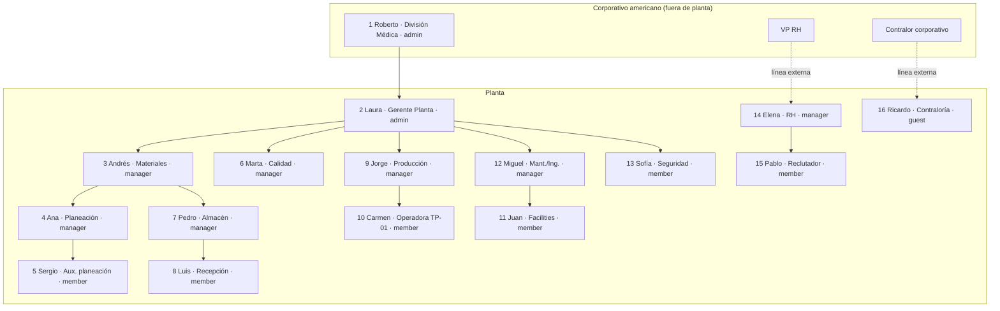
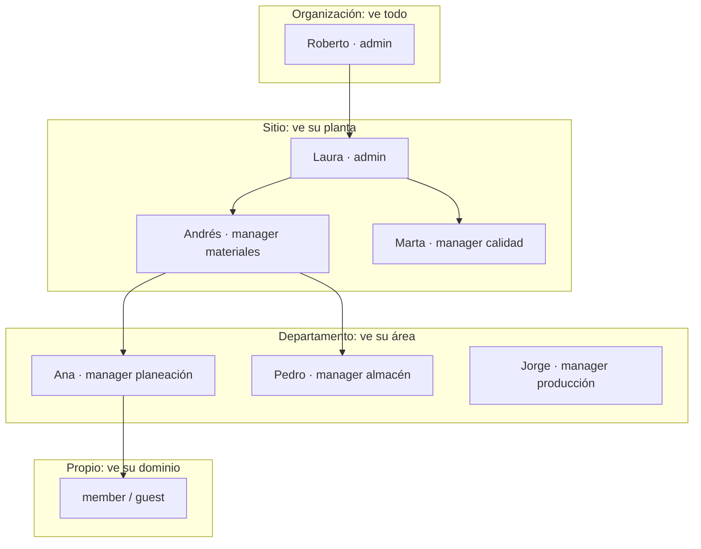
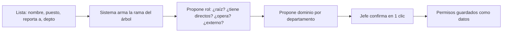

# Roles, matriz de permisos y perfiles demo

Estado: propuesta para afirmación documental 16-oct (issue #29).
Dueño: Carlos. Alcance: solo matriz y perfiles. Dataset y
documentos son #9. La aceptación técnica llega cuando el motor de
#5 pase las pruebas del §16; son estados distintos.

Nota: el BRIEF-29 y `MODELO-DATOS.md` nombran códigos atados al
negocio (`planeacion`, `calidad`, `almacen`). Este documento los
reemplaza por roles fijos de jerarquía, sin una sola palabra del
negocio. Actualizar esos archivos toca a #58/#59/#5, no a este issue.

## 1. La idea en una línea

Como Figma: el de arriba crea su entorno e invita hacia abajo.
Cada jefe asigna a sus directos, nadie otorga más de lo que tiene,
el de arriba ve todo lo de abajo y los de abajo solo ven su parte.
Al recibir la lista de usuarios, el sistema propone la ubicación y
el rol casi en automático; el jefe confirma en 1 clic.

Sin cima fija (anti-sesgo): ninguna persona es la raíz del sistema.
La autoridad es relativa —cada nodo manda sobre su subárbol— así que
si mañana aparece gente por encima de Roberto, o un sitio trae más
niveles y más personas, nada se reescribe: los permisos existentes
siguen valiendo porque nunca dijeron "el de hasta arriba", solo
"tu subárbol". Cada sitio trae su propia forma sin afectar a los demás.

## 2. Roles fijos (no saben de negocios)

Cuatro códigos en inglés, válidos para cualquier empresa o planta.
Ninguno menciona departamentos, máquinas ni industrias.

| Rol | Significa | Regla |
|---|---|---|
| `admin` | Administra su subárbol: invita, asigna y configura. **No es superusuario**: no ve fuera de su subárbol salvo grant multisitio explícito, ni libera ni confirma por ser `admin` | Solo reparte lo que recibió; administrar usuarios no otorga liberación |
| `manager` | Tiene gente a cargo. **No confirma por ser `manager`**: confirmar, liberar y publicar exigen grants explícitos | Ve su subárbol; actúa solo con capacidad otorgada |
| `member` | Opera y registra | Ve y sube solo su dominio asignado |
| `guest` | Solo consulta (interno de solo-lectura o externo invitado) | Lectura acotada; si es externo, con vigencia obligatoria |

El rol aporta capacidades base; el alcance es un límite
independiente sobre los recursos. `admin` y `manager` ven con las
mismas reglas (su subárbol + sus dominios); la diferencia entre
ellos es administrativa (`manage_users`, `manage_permissions`,
`manage_config`), no de visibilidad.

Excepción multisitio (H-01): el aislamiento por planta (ADR-0014) es
la regla; Roberto accede a varios sitios por **grants explícitos por
sitio**, no por su rol. Ve consolidados de sus sitios siempre, y
detalle solo donde tenga grant. Sin grant, el filtro de planta lo
frena como a cualquiera.

Cómo se propone solo con la lista de usuarios (sugerencia, no veredicto):

| Dato de entrada | Propuesta automática |
|---|---|
| ¿Crea el entorno o lo administra todo? | `admin` |
| ¿Tiene gente a cargo? | `manager` |
| ¿Registra u opera diario? | `member` |
| ¿Solo consulta? | `guest` (+ `externo` si es de fuera) |
| ¿A quién reporta? | Esa es su rama del árbol |
| ¿De qué departamento es? | Ese es su `dominio` inicial |

Si la información es ambigua, acceso mínimo + pedir aclaración. La
asignación efectiva se registra con autor, fecha, motivo y versión de
la política. El puesto nunca deduce permisos privilegiados por sí solo
(ser jefe de Producción no libera lotes; RH amplio no ve producción).

## 3. Matriz rol × acción

| Rol | ver | subir | confirmar | invitar / configurar |
|---|---|---|---|---|
| `admin` | todo su subárbol | sí | no opera diario | sí, dentro de su subárbol |
| `manager` | todo su subárbol | sí | sí, dentro de su alcance | invita a sus directos |
| `member` | su dominio asignado | sí, su dominio | no | no |
| `guest` | lectura asignada | no | no | no |

Tres garantías: nadie ve fuera de su subárbol; nadie otorga más de
lo que tiene; la IA consultiva hereda el mismo filtro (si Juan solo
ve su dominio, la IA solo le responde con ese dominio).

Catálogo de acciones (el motor evalúa estas, no las 4 gruesas):

| Acción | Autoriza |
|---|---|
| `read` | Consultar un recurso |
| `download` | Descargar original o derivado |
| `create` | Crear registro o subir archivo |
| `update` | Modificar campos permitidos |
| `submit` | Enviar a revisión |
| `confirm` | Confirmar extracción o dato (no libera lote) |
| `release` | Liberación operativa autorizada (R-Q1) |
| `quarantine` | Mandar a cuarentena o cambiar su estado |
| `manage_users` | Invitar, suspender y asignar usuarios |
| `manage_permissions` | Conceder o revocar capacidades |
| `manage_config` | Cambiar reglas y configuración del sitio |
| `view_audit` | Consultar bitácoras e historiales |

`propio` significa: registros que creé + registros asignados a mí,
dentro de mis dominios, mientras la asignación esté vigente. Al
reasignar, el acceso operativo cambia pero la autoría histórica se
conserva; quien creó y ya no tiene acceso no sigue viendo el
registro salvo política expresa de auditoría. Nunca pierde lo que
otro debe revisar: si Juan registra un paro que Miguel revisa,
ambos lo ven.

Denegación: por defecto todo está denegado; la denegación explícita
gana sobre cualquier grant; un grant de nivel bajo no anula una
prohibición de nivel alto sin operación administrativa expresa y
auditada; sin política aplicable, se deniega. Esto lo implementa #5.

Regla única de autorización (conceptual; el motor de #5 define la
evaluación):

`permiso efectivo = identidad activa + acción permitida + alcance
del recurso + dominio autorizado + vigencia + reglas de denegación`

Todo debe cumplirse a la vez. Ejemplo: Andrés tiene alcance `sitio`
pero solo `dominio: materiales`; un documento de Calidad está en su
subárbol pero fuera de sus dominios → denegado salvo grant explícito.

Reportes consolidados (Roberto): política propia. Campos permitidos,
filtros y agregación mínima (sin grupos que permitan reconstruir
registros individuales, nombres o datos sensibles). Consolidado sí;
detalle solo con grant por sitio.

Niveles del árbol (genéricos; en C1 `sitio` = la planta, sin que el
rol lo mencione): `organizacion` → `sitio` → `departamento` → `propio`.

## 4. Reglas del caso con responsables genéricos

| Regla | Severidad | Quién la provoca / resuelve |
|---|---|---|
| R-P1 rollo sin certificado no se programa | BLOQUEO | `member` registra sin certificado → programa bloqueado; `manager` confirma cuarentena |
| R-P2 medida distinta no se programa | BLOQUEO | `member` mide → programa bloqueado |
| R-P3 material ausente bloquea fecha | BLOQUEO | `member` (stock) reporta → se replanifica |
| R-P4 cambio de hermana dispara replan | AVISO | `manager` replanifica; reporte viejo en pausa |
| R-Q1 solo supervisión libera | BLOQUEO | `manager` con alcance de liberación; nadie se auto-libera |
| R-A1 paro > 30 min exige motivo | BLOQUEO | quien registra el turno (`member`) pone motivo; su `manager` lo ve |
| R-T1 stock mínimo bloquea orden | BLOQUEO | `member` reporta stock; programa bloqueado |

Las reglas viven como datos en `ReglaValidacion` (ADR-0009), nunca como `if`.

Distinción formal: **escribir** en dominio propio (un `member` sube
sus recepciones) vs **mutar estado** sobre dominios ajenos. Lo
segundo exige capacidades específicas, cada una con alcance y
vigencia propios —no existe un permiso genérico de mutación—.
Marta (`dominio: calidad`) opera con estos grants:

| Capacidad | Sobre qué | Vigencia |
|---|---|---|
| `release_lot` | liberar lotes (R-Q1), todos los dominios del sitio | permanente, con revisión anual |
| `quarantine_lot` | mandar a cuarentena, todos los dominios del sitio | permanente, con revisión anual |
| `confirm` | confirmar extracciones y datos, `dominio: calidad` | permanente, con revisión anual |

Liberar un lote, cuarentenar una recepción y cambiar el estado de
una orden no son equivalentes y nunca comparten un mismo grant.

Tres actos distintos, tres permisos distintos: confirmar una
extracción no libera el lote; liberar el lote no publica el dato
oficial; subir un archivo no autoriza a publicar. Cada uno exige su
grant y deja su evidencia (actor, versión del dato, regla, estado).

## 5. Organigrama-matriz de Baja SterilPack (ficticio, sintético)

Fuente: `CASO.md` (planta sintética, ~140 personas, 5 máquinas,
3 turnos Lun–Vie). Nombres ficticios. El elenco que vive el incidente
"el rollo fantasma" (`CASO.md`) son 8 activos —Ana, Sergio, Pedro,
Luis, Marta, Jorge, Carmen y Miguel— más Andrés como jefe. El resto
(Roberto, Laura, Juan, Sofía, Elena, Pablo, Ricardo) es contexto:
corporativo, RH, Contaduría y Seguridad.

| # | Nombre | Puesto | Depto | Reporta a | Rol sistema | Responsabilidades | Problemas que vive |
|---|---|---|---|---|---|---|---|
| 1 | Roberto | Gerente de la División Médica | Corporativo americano | Corporativo global (fuera del sistema) | `admin`, organizacion | Crea el entorno, asigna a cada gerente de planta como jefe de la suya; nunca está en planta | Ve reportes consolidados, sin detalle en tiempo real |
| 2 | Laura | Gerente de Planta | Gerencia | Roberto | `admin`, sitio | Administra su planta e invita a sus gerentes y jefes | Paros por planta hermana: material, medida, tardanza |
| 3 | Andrés | Gerente de Materiales | Materiales | Laura | `manager`, sitio (dominio materiales) | Dueño de flujo de materiales: planeación, compras, almacén, inventarios | Si el material falla, todo lo demás se para |
| 4 | Ana | Planeadora | Planeación | Andrés | `manager`, departamento | Emite programa semanal, mezcla 3-4 fuentes a mano | Vive el problema: replanifica por R-P1, R-P2, R-P3, R-P4 |
| 5 | Sergio | Auxiliar de planeación | Planeación | Ana | `member`, propio | Descargas externas: promesas, inventario, embarques hermanas | Datos dispersos en Excel + correo + descargas |
| 6 | Marta | Jefa de Calidad | Calidad | Laura | `manager`, sitio (con alcance de liberación) | Libera QA y confirma dato oficial (R-Q1), peel test | Producción no se auto-libera; escaneados dispersos |
| 7 | Pedro | Jefe de Almacén | Almacén | Andrés | `manager`, departamento | Stock, inventarios, R-T1 mínimo film/Tyvek | Material ausente bloquea fecha (R-P3); tardanzas |
| 8 | Luis | Almacenista recepción | Almacén | Pedro | `member`, propio | Registra `rollo_id`, medida, certificado, condición | Sin certificado no se programa (R-P1); medida (R-P2) |
| 9 | Jorge | Jefe de Producción | Producción | Laura | `manager`, departamento | Asigna máquina/material, corte y sellado | Rollo, material o medida equivocados |
| 10 | Carmen | Operadora piso TP-01 | Producción | Jorge | `member`, propio | Excel por turno: buenas, merma, paros | Paro > 30 min exige motivo (R-A1) |
| 11 | Juan | Auxiliar facilities | Mantenimiento | Miguel | `member`, propio, `dominio: mantenimiento-facilities` | Repara diario, reporta paros de su sección | No le sirven datos de máquinas; scope fino (ver §7) |
| 12 | Miguel | Jefe de Mantenimiento e Ingeniería | Mantenimiento e Ingeniería | Laura | `manager`, departamento | Paros, cambios de ingeniería por correo | Avisos de hermanas y cliente por correo suelto |
| 13 | Sofía | Seguridad e Higiene | Seguridad | Laura | `member`, departamento | Temperatura/humedad de piso, listas de asistencia | Área blanca controlada, no cleanroom certificado |
| 14 | Elena | Gerente de RH en planta | RH | VP de RH corporativo (fuera del sistema) | `manager`, sitio, `dominio: rh` | Reclutamiento, capacitación y perfiles con su equipo en planta; no reporta a la gerencia de planta | Doble línea: opera en planta, responde al corporativo |
| 15 | Pablo | Reclutador | RH | Elena | `member`, propio | Entrevistas y listas de asistencia | Solo ve su dominio |
| 16 | Ricardo | Contralor en planta | Contaduría | Contralor corporativo (fuera del sistema) | `guest`, su dominio | Presenta costos y embarques en planta; su jefe está en el corporativo | Opera en planta, responde fuera de ella; nada operativo |
| — | Externo | — | — | quien lo invita | `guest` con vigencia | — | Acceso explícito por subárbol + dominio + vigencia |

Roberto ve todos los sitios sin pisar planta; Laura ve su planta;
cada jefe ve su departamento; cada operario ve su dominio. Nadie ve
de lado ni hacia arriba salvo su jefe. Elena y Ricardo responden al
corporativo aunque trabajen en planta. Otro sitio puede traer otra
forma (más niveles, más gente) sin tocar esta.

Notas: Sofía es `member` con alcance `departamento` (no `propio`)
porque registra condiciones de todo el piso, no datos suyos.
Mantenimiento e Ingeniería son un solo nodo (`mantenimiento`,
responsable Miguel); `maquinas` e `ingenieria` son dominios dentro
de él, no departamentos separados.

## 6. Perfiles demo (filas 4, 6 y 11 de la matriz; van a #9)

| Persona | Puesto ficticio | Rol + alcance | Qué hace cada día | Qué toca |
|---|---|---|---|---|
| Ana | Planeadora | `manager`, departamento | Emite el programa semanal, reprograma por R-P1..P4 | `programa_planeacion`, `correo_hermana` |
| Marta | Jefa de calidad | `manager`, sitio (liberación) | Libera rollos y programas (R-Q1), confirma dato oficial | `escaneado` (peel test), cuarentenas |
| Juan | Auxiliar mantenimiento facilities | `member`, propio, su dominio | Repara diario, reporta paros con motivo (R-A1) | `excel_turno` (su sección), avisos |

## 7. Ejemplo trabajado: Juan y el mapeo casi automático

Con la lista de usuarios (nombre, puesto, reporta a Miguel,
departamento mantenimiento), el sistema propone sin que nadie
configure nada:

- Rama: debajo de Miguel, en su departamento.
- Rol: `member` (no tiene gente a cargo, registra diario).
- Dominio: el de su departamento, acotable a su sección.
- Miguel solo confirma en 1 clic o mueve 1 toggle.

La IA que le responde a Juan solo recupera de su dominio, así se
limita el acceso a la información incluso para generar respuestas.
Lo mismo vale para subdepartamentos, corporativo o externos.

## 8. Receta para Configuración 2

1. Roberto (o Laura) crea el sitio 2 como dato, sin código.
2. Asigna al gerente del sitio 2 como `admin` de ese sitio.
3. Ese gerente invita hacia abajo con la misma tabla del §5.
4. Verificación: 2 usuarios de distintos sitios intentan lecturas,
   escrituras y reportes cruzados; todo lo del otro sitio falla
   (evidencia del PR de #8).

## 9. Qué espera cada consumidor

- #5 RBAC: esta matriz como datos semilla (árbol + roles + dominios)
  + alta casi automática + filtro para la IA.
- #9 dataset: perfiles Ana, Marta, Juan con resultado esperado por
  documento (dueño verosímil por ficha).
- Kira: qué ve cada nivel para prototipos (#11).

## 10. Diagramas (Mermaid, versionables)

Ver en https://mermaid.live pegando cada bloque.

### 10.1 Organigrama



Línea continua = reporta en planta. Línea punteada = responde al
corporativo. Elena y Ricardo trabajan en planta sin dar cuenta a Laura.

### 10.2 Cómo funcionan los roles sobre el árbol



Regla visual: cada caja ve todo lo que cuelga debajo de ella y
nada de lo que está a los lados ni arriba (salvo su jefe).

### 10.3 Alta casi automática de un empleado nuevo



## 11. Valores semilla para la BD (Configuración 1)

Lo genérico es el mecanismo; los valores son de la empresa y se
cargan como datos. Columnas según `MODELO-DATOS.md`: `Planta` →
`Departamento` → `Usuario`, con `UsuarioRol` puente y
`Usuario.departamentoId` opcional (corporativo sin departamento).

### 11.1 Plantas (`Planta`)

| código | nombre | responsable |
|---|---|---|
| `C1` | Sitio Configuración 1 | Laura (fila 2) |
| `CORP` | Corporativo americano | Roberto (fila 1) |

### 11.2 Departamentos (`Departamento`)

| código | nombre | planta | responsable |
|---|---|---|---|
| `direccion` | Dirección de División | `CORP` | Roberto |
| `gerencia` | Gerencia de Planta | `C1` | Laura |
| `materiales` | Materiales | `C1` | Andrés |
| `planeacion` | Planeación | `C1` | Ana |
| `almacen` | Almacén | `C1` | Pedro |
| `produccion` | Producción | `C1` | Jorge |
| `mantenimiento` | Mantenimiento e Ingeniería | `C1` | Miguel |
| `calidad` | Calidad | `C1` | Marta |
| `seguridad` | Seguridad e Higiene | `C1` | Sofía |
| `rh` | Recursos Humanos | `C1` | Elena |
| `contaduria` | Contaduría | `C1` | Ricardo |

### 11.3 Dominios (`dominio`, dato en el permiso, no tabla del negocio)

`planeacion`, `almacen`, `produccion`, `mantenimiento-facilities`,
`maquinas`, `ingenieria`, `seguridad`, `rh`, `contaduria`. Un sitio
nuevo trae los suyos sin tocar código.

### 11.4 Usuarios (`Usuario` + `UsuarioRol`)

| nombre | puesto | departamento | reporta a | rol | alcance |
|---|---|---|---|---|---|
| Roberto | Gerente División Médica | — (corporativo) | — | `admin` | organizacion |
| Laura | Gerente de Planta | `gerencia` | Roberto | `admin` | sitio `C1` |
| Andrés | Gerente de Materiales | `materiales` | Laura | `manager` | sitio `C1` |
| Ana | Planeadora | `planeacion` | Andrés | `manager` | departamento |
| Sergio | Auxiliar de planeación | `planeacion` | Ana | `member` | propio |
| Marta | Jefa de Calidad | `calidad` | Laura | `manager` | sitio `C1` + liberación |
| Pedro | Jefe de Almacén | `almacen` | Andrés | `manager` | departamento |
| Luis | Almacenista recepción | `almacen` | Pedro | `member` | propio |
| Jorge | Jefe de Producción | `produccion` | Laura | `manager` | departamento |
| Carmen | Operadora piso TP-01 | `produccion` | Jorge | `member` | propio |
| Juan | Auxiliar facilities | `mantenimiento` | Miguel | `member` | propio + dominio |
| Miguel | Jefe de Mantenimiento e Ingeniería | `mantenimiento` | Laura | `manager` | departamento |
| Sofía | Seguridad e Higiene | `seguridad` | Laura | `member` | departamento |
| Elena | Gerente de RH en planta | `rh` | VP RH corporativo | `manager` | sitio `C1` |
| Pablo | Reclutador | `rh` | Elena | `member` | propio |
| Ricardo | Contralor en planta | `contaduria` | Contralor corporativo | `guest` | su dominio |

Reglas semilla: la referencia primaria de la persona es su `id`
estable (§12); `Planta` + `Departamento` + `nombre` es solo
restricción de login único, no identidad. `Departamento.responsable`
no sustituye a `reporta_a` ni otorga permisos: Ana responde por
Planeación aunque reporte a Andrés; el responsable administra el
nodo, el jefe dirige a la persona, y aprobar operaciones exige grant.
Elena y Ricardo cuelgan del corporativo aunque operen en `C1`;
su `reporta a` vive fuera del sistema y se registra como texto,
no como FK, para que el árbol nunca exija una cima fija.

Esto alimenta a #59 (seed C1) y a #7 (carga): con estas 4 tablas
el diagrama v0 ya tiene qué sostener.

## 12. Bundle del usuario (todo lo que posiciona a alguien en el sitio)

Cada usuario necesita estos datos; sin ellos el sistema no sabe
dónde colgarlo ni qué dejarle ver. Tres orígenes: la empresa los da,
el jefe los confirma, o el sistema los infiere.

| Campo | Para qué posiciona | Origen | Obligatorio |
|---|---|---|---|
| `id` | Identidad interna estable; sobrevive a cambios de planta, depto o login y conserva historial | sistema | sí |
| `nombre` | Identidad ficticia | empresa | sí |
| `usuario` | Login legible (`c1.mantenimiento.juan`); puede cambiar sin crear persona nueva | sistema | sí |
| `tipo_relacion` | `interno` o `externo`. Ricardo es interno de solo-lectura; un proveedor es externo con vigencia obligatoria | empresa | sí |
| `puesto` | Qué hace (texto libre, sin catálogo) | empresa | sí |
| `planta` | Sitio donde opera (adscripción, no jefatura) | empresa | sí |
| `planta_activa` | Sitio en sesión (si trabaja en dos plantas) | usuario elige | no |
| `departamento` | En qué área (código del §11.2) | empresa | sí, salvo corporativo |
| `reporta_a` | Jerarquía (su rama del árbol; texto si es externo al sistema) | empresa | sí |
| `rol` | `admin`, `manager`, `member`, `guest` | sistema propone, jefe confirma | sí |
| `alcance` | `organizacion`, `sitio`, `departamento`, `propio` | sistema propone, jefe confirma | sí |
| `dominios` | Secciones que ve (del §11.3, varios posibles) | sistema propone, jefe confirma | sí, salvo `admin` |
| `grants` | Capacidades explícitas (`release_lot`, `quarantine_lot`, `confirm`…), cada una con alcance, dominios, vigencia, motivo y otorgante | jefe otorga | no (defecto: ninguno) |
| `turno` | T1, T2, T3 (realismo del dataset) | empresa | no |
| `maquinas` | TP-01..TB-03 que opera (realismo del dataset) | empresa | no |
| `vigencia_hasta` | Solo externos e invitados | jefe pone | no |
| `estado` | `activo`, `suspendido`, `baja` | jefe cambia | sí (defecto: `activo`) |
| `contexto_activo` | Dominio y turno de la sesión (si tiene varios) | usuario elige al entrar | no |
| `modificado_por` | Quién tocó el bundle por última vez | sistema | sí |
| `fecha_modificacion` | Cuándo (trazabilidad ISO 13485 / 21 CFR Part 11) | sistema | sí |

Lo mínimo que la empresa entrega por persona: nombre, puesto,
planta, departamento y a quién reporta. Con eso el sistema propone
rol, alcance y dominios (§2); el jefe confirma en 1 clic y el bundle
queda completo. Nada más se configura a mano.

`reporta_a` no es lo mismo que dónde opera: Elena está adscrita a
`C1` pero reporta al VP de RH; Ricardo opera en `C1` pero reporta al
Contralor corporativo. El acceso se hereda de la adscripción y los
grants, nunca del jefe: Elena no recibe permisos sobre otras plantas
por su línea corporativa, ni pierde sus tareas de planta.

Ejemplo (Juan, fila 11):

```json
{
  "id": "usr-0011",
  "nombre": "Juan",
  "usuario": "c1.mantenimiento.juan",
  "tipo_relacion": "interno",
  "puesto": "Auxiliar facilities",
  "planta": "C1",
  "departamento": "mantenimiento",
  "reporta_a": "Miguel",
  "rol": "member",
  "alcance": "propio",
  "dominios": ["mantenimiento-facilities"],
  "grants": [],
  "turno": "T1",
  "maquinas": [],
  "estado": "activo"
}
```

Este bundle es el contrato que #9 usa por ficha (dueño verosímil por
documento) y #61 para generar usuarios coherentes en masa.

## 13. Capacidades delegables (nadie es indispensable)

El rol da la base, pero ninguna capacidad es fija por rol: todo se
otorga, se delega y se bloquea por persona, como datos.

| Campo del otorgamiento | Qué dice |
|---|---|
| `a_quien` | Usuario que recibe |
| `capacidad` | Qué puede hacer (`resolver_conflicto_rollo`, `confirmar_oficial`, `ver_reporte_X`, hasta `ver_menu_basico`) |
| `alcance` + `dominio` | Sobre qué parte del árbol |
| `vigencia_desde` / `vigencia_hasta` | Inicio y fin obligatorios; sin fin no hay grant |
| `motivo` | Por qué se otorga (vacaciones, suplencia, función) |
| `otorgado_por` | Quién lo dio (queda en bitácora) |
| `niega` | `true` = bloqueo explícito: ni lo básico se le permite |

Política uniforme de vigencia (vale para delegaciones y grants
permanentes): todo grant trae inicio, fin, motivo y otorgante, y se
renueva con procedimiento explícito. Las capacidades privilegiadas
(`release_lot`, `manage_permissions`, `manage_config`) caducan y
exigen revisión (anual por defecto); nada privilegiado depende de
que alguien recuerde revocarlo.

Reglas:

1. Solo delega quien tiene la capacidad, y solo dentro de su alcance.
2. Al vencer, el permiso desaparece solo, sin que nadie lo quite a mano.
3. Hasta lo básico se puede bloquear: una denegación explícita gana
   sobre cualquier rol o delegación.
4. Alerta de indispensables: si una capacidad queda en una sola
   persona activa, el sistema avisa y propone respaldo. Nadie es
   indispensable.

Ejemplo: Andrés sale de vacaciones 2 semanas y delega a Ana
`resolver_conflicto_rollo` sobre `dominio: almacen` con
`vigencia_hasta` a su regreso. Ana resuelve cuarentenas esos días;
al vencer, pierde la capacidad sola. Si Andrés no vuelve, Laura la
reasigna sin tocar código.

Esto lo implementa #5 (motor de permisos); aquí queda la regla.

## 14. Emergencias y suplencias (break-glass)

Si una regla BLOQUEO exige liberar y el `manager` capaz no está
(vacaciones, enfermedad, turno T2/T3 sin manager en planta):

1. La solicitud escala automáticamente al superior del subárbol.
2. Si no hay superior disponible, el `admin` del sitio hereda la
   capacidad de liberar **una vez**, validada en servidor, dejando
   marca inmutable `emergencia: true` con motivo en bitácora
   (solo-insert, ADR-0010).
3. Separación de funciones vigente: quien registra no se auto-libera
   ni en emergencia; el que ejecuta el break-glass debe ser distinto
   de quien registró el dato, y las validaciones de reglas siguen
   aplicándose. La excepción queda explícita y auditada.
4. Turnos T2/T3: el superior queda como contacto de guardia; si no
   responde, aplica el punto 2. Ningún lote se queda bloqueado por
   un permiso en una línea parada.

## 15. Bajas, revocación y nodos huérfanos

Cuatro operaciones distintas (no basta `estado = baja`):

1. Baja de cuenta: cierra sesiones, revoca tokens y congela tareas
   en segundo plano y de IA; cada operación verifica autorización
   vigente en servidor.
2. Revisión de permisos: se listan grants, delegaciones recibidas y
   capacidades permanentes; las delegaciones que recibió de otro
   jefe se revisan una por una (no desaparecen ni quedan para
   siempre por decisión implícita).
3. Reasignación de responsabilidades: quién supervisa y aprueba en
   adelante. Heredar el reporte **no** hereda capacidades operativas:
   si Carmen pasa a Laura, Laura no adquiere permisos de Producción
   ni Carmen ve datos de otros operarios.
4. Conservación histórica: la identidad del autor queda en los
   registros anteriores; cambiar de departamento o planta no borra
   historial ni crea persona nueva.
- `suspendido`: congela sesión y capacidades al instante; al
  reactivarse, todo vuelve sin reasignar.
- Huérfanos: si un `manager` causa baja, sus directos reportan
  temporalmente al superior inmediato del subárbol (ej. si Jorge
  sale, Carmen reporta a Laura) hasta nueva asignación. El árbol
  nunca tiene ramas colgando.

## 16. Pruebas esperadas (contrato para #5 motor y #6 cierre)

Resultados esperados, no evidencia: cada caso debe fallar o pasar
así cuando el motor exista. Marcarlos no ejecuta nada en el repo.

| ID | Caso | Resultado esperado |
|---|---|---|
| T01 | Miembro de C1 contra C2 | Denegado leer, modificar y reportar |
| T02 | Roberto multisitio | Solo sitios con grant; consolidado sí, detalle solo con grant |
| T03 | Juan lee otro dominio misma planta | Denegado |
| T04 | Producción libera lote sin grant | Denegado |
| T05 | Subir archivo ≠ publicar oficial | Subir pasa; publicar sin grant se deniega |
| T06 | Grant bajo vs denegación vigente | Gana la denegación |
| T07 | Delegación vencida | Denegado sin intervención manual |
| T08 | Baja con sesión activa | Ninguna acción nueva pasa |
| T09 | Break-glass | Una vez, justificado, auditado, validaciones vigentes |
| T10 | IA con usuario restringido | Ni resúmenes ni agregados filtran lo prohibido |
| T11 | Reasignación de huérfanos | Reporte cambia; capacidades no se amplían |
| T12 | Externo caducado | Sin acceso, incluidas sesiones pendientes |
| T13 | Usuario en dos plantas | Manda la planta activa + sus grants |
| T14 | Cambio de departamento | Sin permisos obsoletos; historial intacto |
| T15 | Registro ya confirmado | Rectificación conserva valor anterior, autor y evidencia |

## Referencias

- `CASO.md` (incluye el incidente "el rollo fantasma" y el alcance del
  caso), `REQUISITOS.md` (RF-06, RF-08)
- ADR-0009 reglas como datos, ADR-0006 IA propone humano dispone
- Fichas de documentos: `../ingenieria/fichas/` (#9)
- Brief: `../briefs/BRIEF-29-matriz-roles-y-dataset.md`
